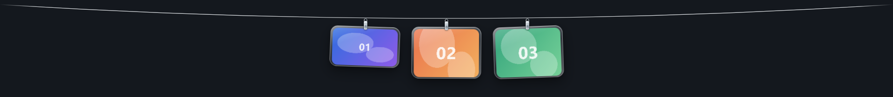
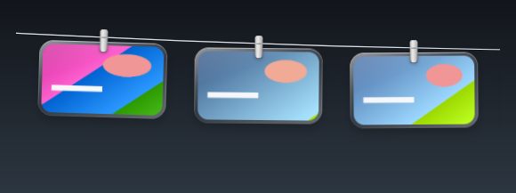
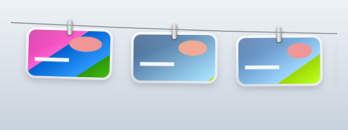
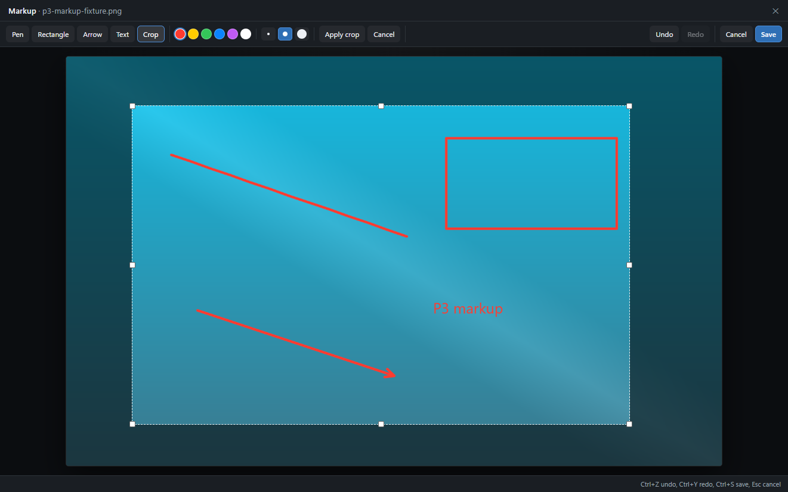
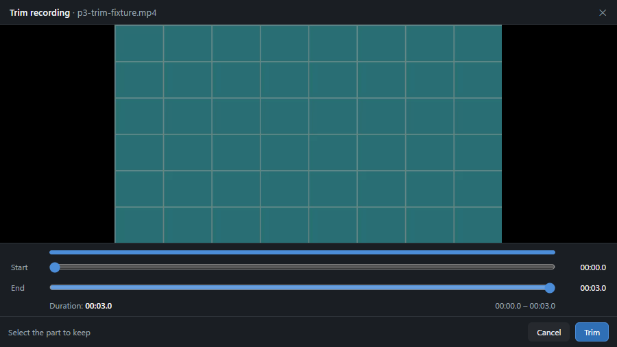
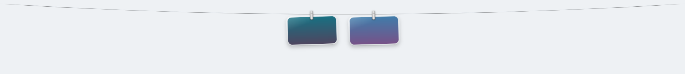
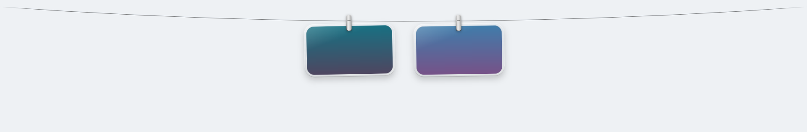
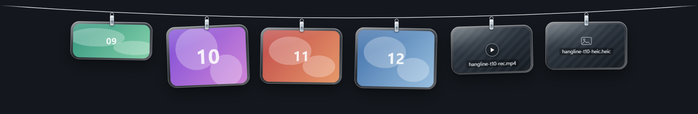
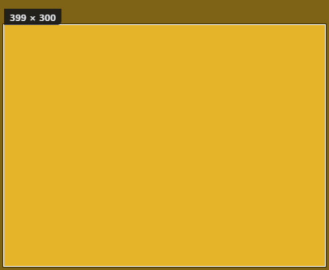
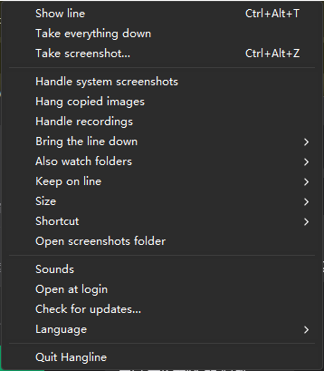

# Hangline

**Screenshots, hung on the line.**

Hangline (晾图绳) is a Windows desktop app that puts a thin clothesline along the
top of your screen. Screenshots land on the line as glass cards, and you can
copy, open, drag away, or take them down from there — no more hunting through
`Screenshot 2026-10-28 103211.png` files on the desktop.

Tauri 2 (Rust) + React 19 + TypeScript + Vite. Windows x64.

Repository: <https://github.com/devin2255/hangline>

> **Status: Hangline 1.1.0 release (P1 core + P2 visual + P3 markup/recording + P4 multi-monitor/settings + P5 packaging + age retention).**
> The public source repository is <https://github.com/devin2255/hangline>; a GitHub Release is produced by the
> `v*` tag workflow when signing secrets are configured, and the installer/portable ZIP can always be built locally.
> The installer is unsigned (SmartScreen may warn). Manual acceptance is documented in
> [`docs/acceptance/P1-core.md`](docs/acceptance/P1-core.md) … [`P5-core.md`](docs/acceptance/P5-core.md).



P2 light/dark glass material (dark and light; composited over neutral gradients; app UI only, no desktop content):




More P2 evidence (motion frame comparison + contact sheet, 60 fps measurement, acceptance matrix):
[`docs/experiments/P2-visual.md`](docs/experiments/P2-visual.md),
[`docs/experiments/P2-perf.json`](docs/experiments/P2-perf.json),
[`docs/acceptance/P2-core.md`](docs/acceptance/P2-core.md).

P3 markup editor and recording trim (app UI only, neutral synthetic fixture):




More P3 evidence: [`docs/experiments/P3-markup-record.md`](docs/experiments/P3-markup-record.md),
[`docs/acceptance/P3-core.md`](docs/acceptance/P3-core.md).

P4 multi-monitor placement under 100%/150% scaling (app UI only, neutral synthetic cards; composited over neutral gradients):




More P4 evidence: [`docs/experiments/P4-multimon-settings.md`](docs/experiments/P4-multimon-settings.md),
[`docs/acceptance/P4-core.md`](docs/acceptance/P4-core.md).

## Install (1.1.0 release)

Windows 10 22H2 or Windows 11, x64. Download the GitHub Release artifacts for the latest tag when available,
or build the installer locally (see [Building](#building-from-source)) with
`node scripts/release/build-release.mjs --sign`.

- `Hangline_1.1.0_x64-setup.exe` — per-user install to `%LOCALAPPDATA%\Programs\Hangline` (no admin),
  Start-menu shortcut (desktop shortcut optional), HKCU uninstall entry, embedded WebView2
  bootstrapper (network needed only on a machine without WebView2). Uninstall asks whether to keep or delete your Hangline data
  (default: keep).
- `Hangline_1.1.0_x64-portable.zip` — unpack anywhere and run `Hangline.exe`; data still lives in
  `%LOCALAPPDATA%\Hangline` (a true portable mode is post-V1).
- **Unsigned:** Windows SmartScreen shows an unknown publisher; verify the SHA-256 in
  `SHA256SUMS.txt`. Code signing is planned post-V1.
- **Network:** the app is local-only. The **only** request is the update check (daily if
  `autoCheckUpdates` is on, or manual from the tray); updates are signed and verified before install.
  The release endpoint/repository is a placeholder until the operator publishes a GitHub repo.

Release/update/signing/privacy runbook: [`docs/RELEASE.md`](docs/RELEASE.md).


## What it does

- **Four screenshot sources, one line.**
  - Its own region capture (`Ctrl+Alt+S` by default): freeze the screen, drag a
    rectangle, and the crop is hung on the line.
  - The system screenshots folder (`%USERPROFILE%\Pictures\Screenshots`), so
    `Win+PrtScn` and the Snipping Tool's auto-save show up automatically.
  - Clipboard images, so `Win+Shift+S` and other apps' "copy image" land on the
    line. Pure images only — copies that carry text/HTML are ignored.
  - The Xbox Game Bar recordings folder (`视频\Captures`), shown as a card with a
    play badge.
- **Deduplicated.** Content hashes (BLAKE3-64) plus path/revision tracking keep
  one image from being hung twice, whichever source saw it.
- **A line, not a window.** The panel sits in the work area at the top of the
  active monitor, is click-through outside its cards, never takes focus, and
  auto-reveals for 2.5 s when a new screenshot arrives.
- **Everything from the card.** Single click copies the image (PNG + DIBV5 + file drop / CF_HDROP);
  double-click opens it in the default app; drag it out as a real file; click
  the × to take it down (own screenshots go to the Recycle Bin, files from
  watched folders are only removed from the line).
- **Markup on long press.** Press and hold a screenshot for 0.45 s: a borderless
  editor opens with pen (3 widths / 6 colours), rectangle, arrow, multiline text,
  crop, and ≥20-step undo/redo. Saving composites the full-resolution PNG,
  atomically replaces the file, refreshes the thumbnail, and the card reloads it
  in place. Files from watched folders open read-only (save disabled).
- **Recording trim on long press.** Game Bar clips show their first frame plus a
  play badge; press and hold to open a trim window with a dual-range slider and a
  `<video>` preview. The export uses the Windows Media Composition pipeline,
  keeps the audio track, replaces the original atomically, and refreshes the
  card — a failed export leaves the original untouched and offers “Open in
  default player”. Trims are capped at 2 GB / 60 min.
- **Browsable when you keep more.** With a 25/50/100 retention limit, the line keeps only the newest N cards (older cards leave the line, their files stay on disk) and the mouse wheel (or a touchpad) scrolls back through them; the newest card is always on the right. 100 cards measured at 60 fps.
- **Automatic cleanup by age (optional).** Tray → **Keep for** keeps cards forever (the default),
  or for the last 7/30/90 days. Expired cards leave the line; Hangline-owned screenshots under
  `%LOCALAPPDATA%\Hangline\Screenshots` are moved to the Recycle Bin (undoable), while files in
  folders you watch, system screenshots and recordings are never deleted. The sweep runs at
  startup, hourly while the app runs, and immediately after you change the window.
- **Out of the way when you are gaming.** Full-screen apps, presentations and busy states hide the line automatically and it returns within a second; “Over full-screen apps” only applies when you have pinned the line.
- **Tray settings.** Watch switches, extra watched folders (up to 3), keep
  count and keep-for window, card size (small/medium/large), shortcuts with conflict rollback,
  sounds, open at login, language (English / 简体中文 / follow system), quit.
- **Multi-monitor and per-monitor DPI.** The line follows the pointer across monitors (500 ms dwell), re-scales its cards for 100%/125%/150% screens, and re-places itself when displays change or the taskbar moves.
- **Settings that stick.** Remap both global hotkeys with conflict detection and rollback, start at login through the standard Run key (quoted, path-with-spaces safe), sounds, card size, theme and language.
- **Local and quiet.** No accounts, no telemetry, no analytics, no cloud. The only network
  request is the signed update check (daily when enabled, or manual from the tray).



## Requirements

- **Windows 10 22H2 or Windows 11, x64.** Developed and tested on Windows 11
  26H2 with two 1920×1080 monitors (100% + 150%). Windows 10 22H2 is expected to
  work through the same Tauri 2 / WebView2 stack but has not been tested.
- **WebView2 Runtime.** Built into Windows 11 and most up-to-date Windows 10
  machines; otherwise install the Microsoft Edge WebView2 Evergreen Runtime.
- To build from source:
  - Node.js 22+ and pnpm 10+
  - Rust 1.90+ stable, MSVC toolchain
  - Visual Studio 2022 C++ Build Tools ("Desktop development with C++") and the
    Windows SDK

## Build and run from source

```powershell
pnpm install
cargo build --manifest-path src-tauri/Cargo.toml
pnpm tauri dev
```

`pnpm tauri dev` starts Vite and the Tauri shell. Packaging is implemented (P5):
`node scripts/release/build-release.mjs` builds the unsigned NSIS setup and portable ZIP
(custom NSIS script; this workstation's Tauri bundler is bypassed). To produce a release
executable without an installer:

```powershell
pnpm tauri build --no-bundle
# -> src-tauri/target/release/hangline.exe
```

Quality gates used by the project:

```powershell
pnpm check                                                     # eslint + tsc + vitest + i18n + version
cargo test --manifest-path src-tauri/Cargo.toml                # Rust unit/integration tests
cargo check --manifest-path src-tauri/Cargo.toml --all-targets # 0 warnings
```

## Using it

| Action | What happens |
| --- | --- |
| `Ctrl+Alt+S` (default) | Region capture: freeze the screen, drag a rectangle, release to capture. `Esc` or right-click cancels. |
| `Ctrl+Alt+T` (default) | Show/hide the line (pins it open). |
| New screenshot arrives | The line drops down for 2.5 s, then tucks away. |
| Pointer over the line | The line stays; move the pointer away (or click outside) and it tucks after ~0.5 s. |
| Optional: pointer at the top edge | After 0.5 s the line can drop down (off by default). |
| Single click a card | Copy image to the clipboard (PNG + DIBV5 + file drop / CF_HDROP). A "Copied" pill confirms it. |
| Double click a card | Open the file in the default app (does not touch the clipboard). |
| Drag a card out | Native file drag: drop it on an app to copy, on a folder to move, on the Recycle Bin to delete. The card updates after the drop. |
| × on a card | Take it down. Photos from Hangline's own screenshot folder go to the Recycle Bin; watched-folder files are only removed from the line. |
| Mouse wheel / touchpad | Browse earlier cards when the retention limit is 25/50/100. |
| Tray → Keep for | Age cleanup: keep forever (default) or the last 7/30/90 days. Expired Hangline-owned screenshots go to the Recycle Bin; watched-folder, system-screenshot and recording files are never deleted. |
| Tray icon | Left click toggles the line; right click opens settings: sources, folders, keep count, keep-for window, size, shortcuts, sounds, autostart, check for updates, language, quit. |

Shortcuts can be changed in **Tray → Shortcut**; a shortcut that is already
taken is rejected and the previous one is restored. Extra watched folders are
added with **Tray → Also watch folders → Add folder…** (maximum 3).

The line shows `max(3, min(12, floor((logical panel width - 200) / card spacing)))` cards in
"fit" mode (9 cards on a 1920-logical-px panel at medium size; a 1920 physical
screen at 150% is 1280 logical px, so it fits 6) and keeps the newest
ones; set 25/50/100 to keep more and scroll. Card size can be small, medium or
large. Cards can also expire by age: **Tray → Keep for** defaults to keeping them
forever; a 7/30/90-day window drops older cards and recycles expired Hangline-owned
screenshots (the other sources' files are only taken off the line).

Data lives under `%LOCALAPPDATA%\Hangline\` (`settings.json`,
`state.json`, `Screenshots\`); logs are under
`%LOCALAPPDATA%\app.hangline.Hangline\logs\`.





## Privacy

- **Only one network request: update checks.** Daily when `autoCheckUpdates` is on, or manual
  from the tray; the update endpoint is the only host contacted. No analytics, telemetry,
  accounts, cloud sync, or crash reporting.
- Opening a URL in your default browser (for example a documentation link or the release page
  shown after an update prompt) is only done when you choose it; "Open screenshots folder"
  opens Explorer locally. The updater endpoint is the public repository's GitHub Releases URL
  (`devin2255/hangline`).
- Screenshots and recordings stay on your disk. Hangline copies clipboard images
  and new files from the folders you explicitly watch into
  `%LOCALAPPDATA%\Hangline\Screenshots\`; it does not upload them anywhere.
- **Age cleanup is local and undoable.** When a Keep-for window is set, expired
  Hangline-owned screenshots are moved to the Windows Recycle Bin; files in the
  folders you watch, system screenshots and recordings are never deleted, only
  taken off the line.
- Clipboard capture only accepts pure images and skips copies that look private
  (passwords/text, `ExcludeClipboardContentFromMonitorProcessing`,
  `CanIncludeInClipboardHistory=0`, `org.nspasteboard.ConcealedType`, files).
- Local logs and state files may contain local file paths and event metadata;
  they never contain image data. They stay on your machine.

## Known limitations

Hangline 1.1.0 is a release build; the functional milestones P1–P5 are implemented and the
remaining items are manual/deferred checks (the acceptance documents track them in detail):

- **Manual acceptance is pending.** The following still need a real person on an
  unlocked desktop: physical `Ctrl+Alt+S`/`Ctrl+Alt+T`, real tray clicks, real
  drag targets (WeChat/Figma, folder move, Recycle Bin), pasting from real apps
  (WeChat/QQ/browser), real wheel/touchpad scrolling, real pointer cross-screen
  following, and the folder picker. They are marked `MANUAL-PENDING` — not
  "passed" — in [`docs/acceptance/P1-core.md`](docs/acceptance/P1-core.md).
- **Unsigned.** The 1.1.0 installer/portable ZIP are built by the tag workflow and published on
  GitHub Releases; there is no Authenticode signature (SmartScreen warns). Auto-update is wired and
  signature-verified against the updater public key in `tauri.conf.json` (see `docs/RELEASE.md`).
- **Card right-click menu** is not implemented (V1.1). Today the card actions are
  click / double-click / drag / ×.
- **Annotation/recording trim and full-screen suppression** are implemented in
  source (P3/P4); their manual acceptance lives in the P3/P4 acceptance records.
- **Languages:** only English and Simplified Chinese are built in (more languages are post-V1). A few native error dialogs are not localized yet (some English-only,
  some Chinese-only).
- **HEIC** files have no decoder in the current image pipeline: they still hang
  on the line but show a filename placeholder instead of a thumbnail.
- Clipboard copies that only provide legacy `CF_BITMAP` (some older apps) are not
  captured; browser "copy image" that carries HTML/text is intentionally ignored.
- **Windows 10 22H2 untested**, and only the dual-monitor 100%/150% development
  configuration has been exercised.
- **Power-user polish deferred:** e.g. drag-session watchdog edge cases,
  suspend/resume ordering, tray-folder submenu rebuild churn. None are known to
  block everyday use; they are listed as residual risks in the task reports.

## Project status and roadmap

**P1 — core loop: complete in source** (four screenshot sources, line
behavior, copy/open/drag/take-down, tray/settings/persistence, capture overlay).

**P2 — visual soul: implemented in source** (glass cards, pins and rope; arrival
swing and breeze; fly-in and take-down fall; light/dark material; 4K thumbnail
cache). Manual acceptance is still pending — see
[`docs/acceptance/P2-core.md`](docs/acceptance/P2-core.md); this is not a release.

**P3 — annotate and record: implemented in source** (long-press markup editor with
atomic write-back, Game Bar first-frame cards, WinRT timeline trim; 100× write-back
stress). Manual acceptance pending — see [`docs/acceptance/P3-core.md`](docs/acceptance/P3-core.md).

**P4 — multi-monitor and settings: implemented in source** (full-screen suppression,
retention cap and 100-card scrolling, hotkey conflict detection/rebinding, autostart,
sound, per-monitor DPI placement). Manual acceptance pending — see
[`docs/acceptance/P4-core.md`](docs/acceptance/P4-core.md).

Remaining milestone:

**P5 — release packaging: implemented in source** (unsigned NSIS installer + portable ZIP,
WebView2 bootstrap, keep/delete uninstall prompt, updater with signing keys, CI/release
workflows, README/press kit). See [`P5-core.md`](docs/acceptance/P5-core.md). Remaining:
public download/CI run/code signing and 11-language expansion.

## License and attribution

Hangline is licensed under the [MIT License](LICENSE) (the app is not released yet).
Third-party notices and dependency licenses are in
[`THIRD_PARTY_NOTICES.md`](THIRD_PARTY_NOTICES.md).

Hangline is **inspired by [Tendedero](https://github.com/alejandrobujan/tendedero)**
(MIT with an additional name/icon restriction, © 2026 Alejandro Buján), a macOS screenshot clothesline.
The restriction means Tendedero's name and icon must not be reused; Hangline uses
its own original name/icon/art, so no Tendedero asset permission is needed. Hangline is an
independent Windows implementation: no Tendedero source code, art or translation
text was copied, and the Hangline name, icon and UI art are original to this
project. Hangline is not affiliated with or endorsed by the Tendedero project.

## Documentation

- [Acceptance record — P1 core](docs/acceptance/P1-core.md) (Chinese; environment, gates, evidence matrix, and the manual acceptance checklist)
- [Acceptance record — P2 visual](docs/acceptance/P2-core.md) (Chinese; P2 DoD matrix, 60 fps/frame comparison measurements, manual checklist, known limitations)
- [Acceptance record — P3 markup & recording](docs/acceptance/P3-core.md) (Chinese; M12/M13 matrix, 100× write-back stress, WinRT trim evidence, packaged-CSP proof, manual checklist, known limitations)
- [Acceptance record — P4 multi-monitor & settings](docs/acceptance/P4-core.md) (Chinese; M2/M3/M4/M14/M15 matrix, 100-card 60 fps, full-screen suppression, hotkey/autostart evidence, manual checklist, known limitations)
- [P2 frame comparison and contact sheet](docs/experiments/P2-visual.md), [P2 performance data](docs/experiments/P2-perf.json)
- [P3 markup & recording methods and evidence](docs/experiments/P3-markup-record.md), [P3 reference data](docs/experiments/P3-reference.md)
- [P4 multi-monitor/full-screen/settings evidence](docs/experiments/P4-multimon-settings.md)
- [P0 technical gate report](docs/experiments/P0-report.md)
- P1/P2/P3/P4 experiment evidence: [`docs/experiments/`](docs/experiments/) (`P1-*`/`P2-*`/`P3-*`/`P4-*` plus app-UI-only or neutral-composited screenshots)
- [Acceptance record — P5 release](docs/acceptance/P5-core.md) (Chinese; installer/portable/updater/lifecycle matrix, sizes and hashes, manual checklist, known limitations)
- [Release, update and signing runbook](docs/RELEASE.md), [CHANGELOG](CHANGELOG.md), [press kit](docs/press/)
- [Design spec](docs/superpowers/specs/2026-10-28-hangline-windows-design.md), [P1 implementation plan](docs/superpowers/plans/2026-10-29-hangline-windows-core.md), [P2 visual plan](docs/superpowers/plans/2026-11-02-hangline-windows-visual-soul.md), [P3 markup/recording plan](docs/superpowers/plans/2026-11-03-hangline-windows-markup-record.md), [P4 multi-monitor/settings plan](docs/superpowers/plans/2026-11-04-hangline-windows-p4-multimon-settings.md) and [P5 release plan](docs/superpowers/plans/2026-11-04-hangline-windows-p5-release.md)

[简体中文 README](README.zh-Hans.md)
