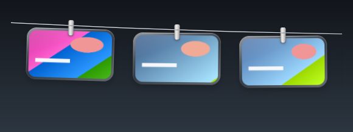
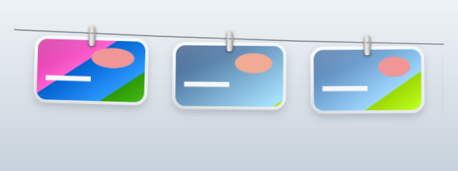
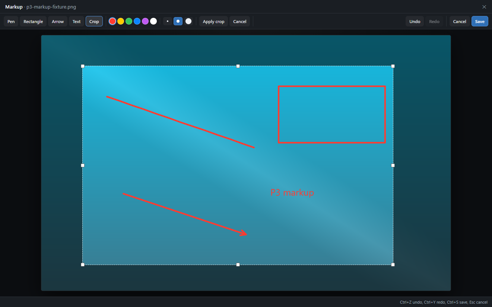
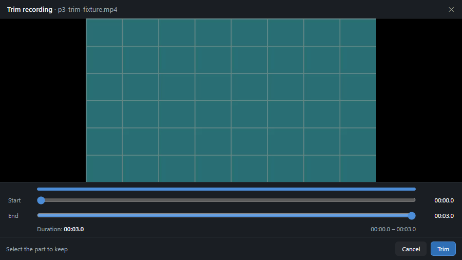
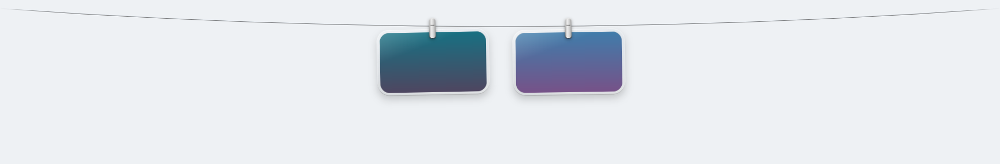
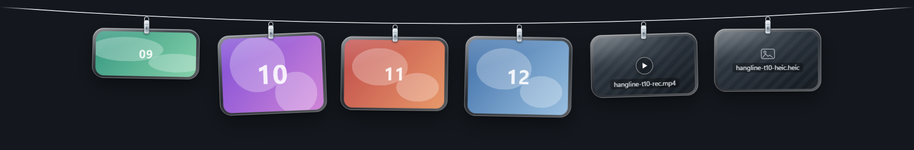
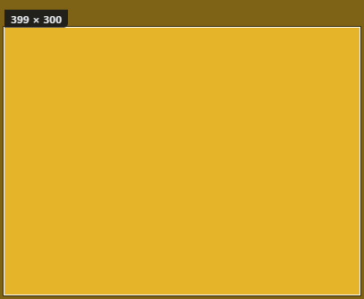
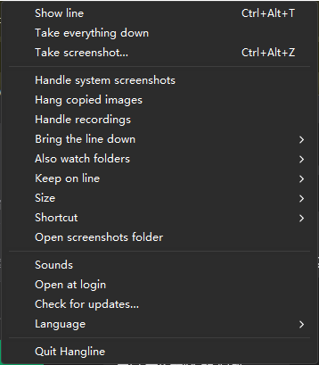

# Hangline（晾图绳）

**截图，晾在绳上。**

Hangline 是一个 Windows 桌面应用：它把一条细绳挂在屏幕顶部，截图会自动「落」上绳变成玻璃卡片（P2 已实现玻璃材质、夹子、绳的摆动、飞入/坠落与深浅色；人工验收待执行），你可以随时复制、打开、拖走或取下来——不必再在桌面上翻找 `Screenshot 2026-10-28 103211.png` 之类的文件。

技术栈：Tauri 2（Rust）+ React 19 + TypeScript + Vite，Windows x64。

仓库：<https://github.com/devin2255/hangline>

> **状态：Hangline 1.0.0 源码发布（P1 核心 + P2 视觉 + P3 标注/录屏 + P4 多屏设置 + P5 打包）。**
> 公开源码仓库为 <https://github.com/devin2255/hangline>；配置签名 secrets 后，`v*` tag 工作流会生成 GitHub Release，也可随时在本地构建安装包与 portable ZIP。安装包未签名（SmartScreen 可能提示未知发布者）。人工验收记录见 [`docs/acceptance/P1-core.md`](docs/acceptance/P1-core.md) … [`P5-core.md`](docs/acceptance/P5-core.md)。


P2 亮/暗玻璃材质（中性渐变合成；仅应用 UI，无桌面内容）：




更多 P2 证据（运动帧对比与接触表、60 fps 实测、验收矩阵）：[`docs/experiments/P2-visual.md`](docs/experiments/P2-visual.md)、[`docs/experiments/P2-perf.json`](docs/experiments/P2-perf.json)、[`docs/acceptance/P2-core.md`](docs/acceptance/P2-core.md)。

P3 标注编辑器与录屏裁剪（仅应用 UI，中性合成 fixture）：




更多 P3 证据：[`docs/experiments/P3-markup-record.md`](docs/experiments/P3-markup-record.md)、[`docs/acceptance/P3-core.md`](docs/acceptance/P3-core.md)。

P4 多屏 100%/150% 缩放放置（仅应用 UI，中性合成卡片；面板截图合成到中性渐变）：




更多 P4 证据：[`docs/experiments/P4-multimon-settings.md`](docs/experiments/P4-multimon-settings.md)、[`docs/acceptance/P4-core.md`](docs/acceptance/P4-core.md)。

## 安装（1.0.0 源码发布）

Windows 10 22H2 或 Windows 11，x64。可从 GitHub Release（配置后由 tag 工作流生成）下载，或按下方“从源码构建”用 `node scripts/release/build-release.mjs --sign` 在本地构建发布产物。

- `Hangline_1.0.0_x64-setup.exe` —— 当前用户安装到 `%LOCALAPPDATA%\Programs\Hangline`（无需管理员），开始菜单快捷方式（桌面快捷方式可选）、HKCU 卸载项、内置 WebView2 引导（仅在没有 WebView2 的机器上需要联网）。卸载时会询问保留或删除 Hangline 数据（默认保留）。
- `Hangline_1.0.0_x64-portable.zip` —— 解压即用；数据仍在 `%LOCALAPPDATA%\Hangline`（真正的便携模式属 V1.1）。
- **未签名：** SmartScreen 会提示未知发布者；请用 `SHA256SUMS.txt` 校验。代码签名计划在 V1 之后。
- **网络：** 应用保持本地；**唯一**网络请求是更新检查（`autoCheckUpdates` 开启时每日一次，或托盘手动检查），更新包会先验签再安装。发布端点/仓库目前是占位，需运营者创建 GitHub 仓库后替换。

发布/更新/签名/隐私手册：[`docs/RELEASE.md`](docs/RELEASE.md)。


## 功能

- **四种截图来源，汇到同一条绳上。**
  - 内置区域截图（默认 `Ctrl+Alt+S`）：冻结屏幕 → 拖框 → 裁剪结果上栏。
  - 系统截图目录（`%USERPROFILE%\Pictures\Screenshots`）：`Win+PrtScn`、截图工具的「自动保存」落盘即上栏。
  - 剪贴板图片：`Win+Shift+S` 或其它应用「复制图片」后自动上栏；只收纯图片，带文本/HTML 的复制会被忽略。
  - Xbox Game Bar 录屏目录（`视频\Captures`）：以带播放角标的卡片上栏。
- **自动去重。** 内容哈希（BLAKE3-64）+ 路径/revision 跟踪，同一张图无论被哪个来源看到，都只上栏一次。
- **是一条线，不是一个窗口。** 面板贴在当前显示器工作区顶部，卡片以外区域点击穿透、从不抢焦点；新截图到达时自动展开 2.5 s 再收起。
- **卡片就是操作入口。** 单击复制图片（PNG + DIBV5 + 文件拖放 CF_HDROP）；双击用默认程序打开；按住拖出是原生文件拖拽；点 × 取下线（自有截图进回收站；监听目录里的文件只下线、不删除）。
- **长按标注。** 长按截图 0.45 s 打开无边框编辑器：画笔（3 粗细/6 色）、矩形、箭头、多行文字、裁剪、≥20 步撤销；保存时合成全分辨率 PNG、原子替换原文件、刷新缩略图，卡片立即换新。监听目录里的文件只读（保存禁用）。
- **长按裁剪录屏。** Game Bar 录屏显示首帧 + 播放角标；长按打开裁剪窗口（双滑块 + `<video>` 预览）。导出走 Windows Media Composition，保留音频轨，原子替换原文件并刷新卡片；失败时原文件不动，并提供“用默认播放器打开”。上限 2 GB / 60 分钟。
- **留得多时可翻阅。** 保留数量设为 25/50/100 后，线上只保留最新 N 张（旧卡片下线，**文件仍留在截图目录**），滚轮（或触控板）可翻阅；最新一张始终在右侧。100 张实测 60 fps。
- **全屏时不打扰。** 全屏游戏/演示/忙状态会自动隐藏线，退出后 1 秒内恢复；「全屏应用上」只在手动固定线时生效。
- **托盘设置。** 监听开关、额外监听目录（最多 3 个）、保留数量、卡片尺寸（小/中/大）、快捷键（含冲突回滚）、声音、开机启动、语言（English / 简体中文 / 跟随系统）、退出。
- **多显示器与逐显示器 DPI。** 线跟随鼠标指针跨屏（停留 500 ms 后迁移），按 100%/125%/150% 缩放重排卡片，并在显示器变化/任务栏移动后重新贴边。
- **设置可持久。** 两个全局热键可改键（冲突检测+回滚），开机启动走标准 Run 键（带引号、支持含空格路径），声音、尺寸、主题、语言均可设置。
- **本地、安静。** 没有账号、遥测、统计或云同步；唯一的网络请求是带签名的更新检查（开启时每日一次，或托盘手动检查）。



## 环境要求

- **Windows 10 22H2 或 Windows 11，x64。** 开发与验证环境为 Windows 11 26H2，双 1920×1080 显示器（100% + 150%）。Windows 10 22H2 预期可通过同一 Tauri 2 / WebView2 技术栈运行，但尚未实测。
- **WebView2 Runtime。** Windows 11 与多数已更新的 Windows 10 已内置；否则请安装 Microsoft Edge WebView2 Evergreen Runtime。
- 从源码构建还需要：
  - Node.js 22+ 与 pnpm 10+
  - Rust 1.90+ stable（MSVC toolchain）
  - Visual Studio 2022 C++ 生成工具（「使用 C++ 的桌面开发」）与 Windows SDK

## 从源码构建与运行

```powershell
pnpm install
cargo build --manifest-path src-tauri/Cargo.toml
pnpm tauri dev
```

`pnpm tauri dev` 会同时启动 Vite 与 Tauri 外壳。打包已在 P5 实现：`node scripts/release/build-release.mjs` 生成未签名 NSIS 安装包与 portable ZIP（自定义 NSIS 脚本；本机绕开 Tauri bundler）。若要生成不带安装包的 release 可执行文件：

```powershell
pnpm tauri build --no-bundle
# -> src-tauri/target/release/hangline.exe
```

项目使用的质量闸门：

```powershell
pnpm check                                                     # eslint + tsc + vitest + i18n + 版本一致性
cargo test --manifest-path src-tauri/Cargo.toml                # Rust 单元/集成测试
cargo check --manifest-path src-tauri/Cargo.toml --all-targets # 0 warnings
```

## 使用方式

| 操作 | 行为 |
| --- | --- |
| `Ctrl+Alt+S`（默认） | 区域截图：冻结屏幕，拖框，松开即截取；`Esc` 或右键取消。 |
| `Ctrl+Alt+T`（默认） | 显示/隐藏线（固定展开）。 |
| 新截图到达 | 线降下 2.5 s，然后收起。 |
| 指针移到线上 | 线保持展开；指针移开（或点击线外）约 0.5 s 后收起。 |
| 可选：指针停在屏幕顶边 | 0.5 s 后展开（默认关闭）。 |
| 单击卡片 | 复制图片到剪贴板（PNG + DIBV5 + 文件拖放 CF_HDROP），显示「已复制」提示。 |
| 双击卡片 | 用默认程序打开文件（不写剪贴板）。 |
| 拖出卡片 | 原生文件拖拽：拖到应用＝复制，拖到文件夹＝移动，拖到回收站＝删除；卡片随结果更新。 |
| 卡片上的 × | 取下线。Hangline 自有截图目录中的图片进回收站；监听目录中的文件只下线、不删除。 |
| 鼠标滚轮 / 触控板 | 保留数量为 25/50/100 时翻阅更早的卡片。 |
| 托盘图标 | 左键切换线的显示；右键打开设置：来源开关、监听目录、保留数量、尺寸、快捷键、声音、开机启动、检查更新、语言、退出。 |

快捷键可在 **托盘 → 快捷键** 中修改；新键若已被占用会被拒绝并恢复旧键。额外监听目录通过 **托盘 → 也监听文件夹 → 添加文件夹…** 添加（最多 3 个）。

「放得下多少」模式下，每屏显示 `max(3, min(12, floor((逻辑面板宽度 - 200) / 卡片间距)))` 张卡片（1920 逻辑像素宽、中号尺寸时为 9 张；1920 物理屏在 150% 缩放下逻辑宽 1280，因此为 6 张），保留最新的若干张；设为 25/50/100 可保留更多并滚动查看。卡片尺寸可选小 / 中 / 大。

数据位于 `%LOCALAPPDATA%\Hangline\`（`settings.json`、`state.json`、`Screenshots\`）；日志位于 `%LOCALAPPDATA%\app.hangline.Hangline\logs\`。





## 隐私

- **唯一的网络请求是更新检查。** `autoCheckUpdates` 开启时每日一次，或从托盘手动检查；更新端点是唯一访问的主机。没有统计、遥测、账号、云同步或崩溃上报。
- 只有在用户主动选择时才会用默认浏览器打开链接（例如文档或更新提示里的 release 页面）；「打开截图文件夹」只是本地打开资源管理器。更新端点是 GitHub Releases 占位地址，需运营者发布仓库后替换。
- 截图与录屏留在你的磁盘上。Hangline 只会把剪贴板图片、以及你显式监听目录中的新文件复制到 `%LOCALAPPDATA%\Hangline\Screenshots\`，不会上传到任何地方。
- 剪贴板采集只接受纯图片，并跳过看起来隐私的复制（密码/文本、`ExcludeClipboardContentFromMonitorProcessing`、`CanIncludeInClipboardHistory=0`、`org.nspasteboard.ConcealedType`、文件）。
- 本地日志与状态文件可能包含本地文件路径和事件元数据，但不包含图像内容，且只留在本机。

## 已知限制

Hangline 1.0.0 已作为源码发布；P1–P5 功能里程碑已实现，剩余为需人工/延后验证的项目（详见验收文档）：

- **人工验收待执行。** 以下项目仍需真人在解锁桌面上确认：真实物理 `Ctrl+Alt+S`/`Ctrl+Alt+T`、真实托盘点击、真实拖拽目标（微信/Figma、文件夹移动、回收站）、真实应用粘贴（微信/QQ/浏览器）、真实滚轮/触控板滚动、真人鼠标跨屏跟随、系统文件夹选择器。它们在 [`docs/acceptance/P1-core.md`](docs/acceptance/P1-core.md) 中标记为 `MANUAL-PENDING`，不是「已通过」。
- **未签名、无公开发布。** 1.0.0 安装包/portable ZIP 可本地构建；没有 Authenticode 签名（SmartScreen 会提示未知发布者），本仓库也不发布 GitHub Release。自动更新已接入并验签；发布端点仍是占位，需运营者创建仓库后替换（见 `docs/RELEASE.md`）。
- **卡片右键菜单**未实现（V1.1）。目前卡片操作是单击 / 双击 / 拖出 / ×。
- **标注/录屏裁剪与全屏抑制**已在源码实现（P3/P4）；人工验收见 P3/P4 验收记录。
- **语言：** 目前只内置英文与简体中文（更多语言属后续版本）；少数原生错误对话框尚未本地化（有的仅英文，有的仅中文）。
- **HEIC** 当前图像管线没有解码器：仍会上栏，但显示文件名占位而非缩略图。
- 只提供旧式 `CF_BITMAP` 的剪贴板复制（部分旧应用）不会被采集；浏览器「复制图片」带 HTML/文本时按设计不采集。
- **Windows 10 22H2 未实测**，且只验证过双屏 100%/150% 这一套开发环境。
- **进阶打磨延后：** 例如拖拽会话看门狗边界、挂起/恢复顺序、托盘文件夹子菜单重建频率等。目前没有证据表明它们会阻塞日常使用；完整的残留风险列表见各任务报告。

## 项目状态与路线图

**P1 —— 核心闭环：源码完成**（四种截图来源、绳的展开收起、复制/打开/拖出/取下线、托盘/设置/持久化、自建截图覆盖层）。

**P2 —— 视觉灵魂：源码实现完成**（玻璃卡片/夹子/绳、入场摆动与微风、飞入与坠落、亮/暗材质、4K 缩略图缓存）；人工验收仍待执行，详见 [`docs/acceptance/P2-core.md`](docs/acceptance/P2-core.md)，不代表已发布。

**P3 —— 标注与录屏：源码实现完成**（长按标注编辑器+原子写回、Game Bar 首帧卡片、WinRT 时间轴裁剪、100 次写回压测）；人工验收见 [`docs/acceptance/P3-core.md`](docs/acceptance/P3-core.md)。

**P4 —— 多屏与设置：源码实现完成**（全屏抑制、保留上限与 100 卡滚动、热键冲突检测/改键、开机自启、声音、逐显示器 DPI 放置）；人工验收见 [`docs/acceptance/P4-core.md`](docs/acceptance/P4-core.md)。

剩余里程碑：

**P5 —— 发布打包：源码实现完成**（未签名 NSIS 安装包 + portable ZIP、WebView2 引导、卸载保留/删除数据、带签名密钥的 updater、CI/release 工作流、README/press kit）。见 [`P5-core.md`](docs/acceptance/P5-core.md)。剩余：公开下载/CI 实跑/代码签名与 11 语言扩展。

## 许可与归属

Hangline 以 [MIT License](LICENSE) 授权（1.0.0 源码发布）。第三方声明与依赖许可见 [`THIRD_PARTY_NOTICES.md`](THIRD_PARTY_NOTICES.md)。

Hangline 的形态**灵感来自 [Tendedero](https://github.com/alejandrobujan/tendedero)**（MIT 附加名称/图标限制条款，© 2026 Alejandro Buján），一个 macOS 截图晾衣绳应用。Hangline 是独立的 Windows 实现：没有复制 Tendedero 的源代码、美术或翻译文本；Hangline 的名称、图标与界面美术均为本项目原创。Hangline 与 Tendedero 项目无隶属或背书关系。

## 文档

- [验收记录 —— P1 核心](docs/acceptance/P1-core.md)（环境、质量门、证据矩阵与人工验收清单）
- [验收记录 —— P2 视觉](docs/acceptance/P2-core.md)（DoD 矩阵、60 fps/帧对比实测、人工清单、已知限制）
- [验收记录 —— P3 标注与录屏](docs/acceptance/P3-core.md)（M12/M13 矩阵、100 次写回压测、WinRT 裁剪证据、打包 CSP 证明、人工清单、已知限制）
- [验收记录 —— P4 多屏与设置](docs/acceptance/P4-core.md)（M2/M3/M4/M14/M15 矩阵、100 卡 60 fps、全屏抑制、热键/自启证据、人工清单、已知限制）
- [P2 帧对比与接触表](docs/experiments/P2-visual.md)、[P2 性能数据](docs/experiments/P2-perf.json)
- [P3 标注与录屏方法与证据](docs/experiments/P3-markup-record.md)、[P3 参考数据](docs/experiments/P3-reference.md)
- [P4 多屏/全屏/设置证据](docs/experiments/P4-multimon-settings.md)
- [P0 技术门禁报告](docs/experiments/P0-report.md)
- P1/P2/P3/P4 实验证据：[`docs/experiments/`](docs/experiments/)（`P1-*`/`P2-*`/`P3-*`/`P4-*` 与仅含应用 UI 或中性合成的证据图）
- [验收记录 —— P5 发布](docs/acceptance/P5-core.md)（安装/portable/更新/生命周期矩阵、体积与哈希、人工清单、已知限制）
- [发布/更新/签名手册](docs/RELEASE.md)、[CHANGELOG](CHANGELOG.md)、[Press kit](docs/press/)
- [设计文档](docs/superpowers/specs/2026-10-28-hangline-windows-design.md)、[P1 实现计划](docs/superpowers/plans/2026-10-29-hangline-windows-core.md)、[P2 视觉计划](docs/superpowers/plans/2026-11-02-hangline-windows-visual-soul.md)、[P3 标注/录屏计划](docs/superpowers/plans/2026-11-03-hangline-windows-markup-record.md)、[P4 多屏/设置计划](docs/superpowers/plans/2026-11-04-hangline-windows-p4-multimon-settings.md)与 [P5 发布计划](docs/superpowers/plans/2026-11-04-hangline-windows-p5-release.md)

[English README](README.md)
