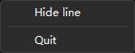
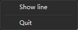

# P0-E3 实验报告：全局热键 + 托盘 + 单实例

- **日期**：2026-10-29（本地时间 10:55–11:03，UTC+8；应用日志时间戳为 UTC）
- **分支**：`feat/core`（Task 3）
- **结论**：E3「全局热键 / 托盘 / 单实例」在自动化可测范围内 **PASS**。默认热键注册与触发、冲突时保留旧键、面板初始隐藏 + ready 握手、托盘菜单与动作、单实例二次启动 toggle、隐藏时停止轮询均通过运行时验证；真实物理键盘、真实任务栏点击、冲突气泡等主观/人工项见第 5 节。
- **证据截图**（均为托盘菜单精确裁剪，仅含菜单本身，避免提交无关桌面内容）：
  - `docs/experiments/P0-E3-tray-menu-visible.png`：面板可见时菜单首项为 **Hide line** + 分隔线 + **Quit**。
  - `docs/experiments/P0-E3-tray-menu-hidden.png`：面板隐藏时首项为 **Show line**（文案随状态变化）。

## 1. 环境

| 项 | 值 |
| --- | --- |
| 操作系统 | Windows 11 家庭版 中文版，10.0.26300（26H2），UBR 26300.9711 |
| 会话 | RustDesk 远程桌面；主屏 1920×1080 @ 96 DPI（100%），左侧副屏 1920×1080 @ 144 DPI（150%） |
| WebView2 | 156.0.4314.50 |
| Node / pnpm | 22.17.1 / 10.30.3 |
| Rust / Tauri | 1.90.0（MSVC）/ tauri 2.12.5，`tauri-plugin-global-shortcut` 2.4.1（`global-hotkey` 0.8.0） |
| 构建 | debug（`cargo build`，dev profile，前端由 `pnpm dev` 提供） |

## 2. 运行方式与 agent 沙箱限制

与 E1/E2 相同（见 `docs/experiments/P0-E1E2.md` §2）：本 agent 沙箱内 **workspace 中的 exe 无法写入 `%LOCALAPPDATA%`**，`pnpm tauri dev` 会在 log 插件初始化处失败（os error 5）。因此本次实验仍采用等价方式：

```powershell
pnpm dev                                                        # Vite :5173
cargo build --manifest-path src-tauri/Cargo.toml
Copy-Item src-tauri\target\debug\hangline.exe $env:TEMP\hangline-e3\hangline.exe
& $env:TEMP\hangline-e3\hangline.exe                            # stdout/stderr 重定向到 app*.log
```

运行时通过 Win32 P/Invoke 观察：`EnumWindows`/`IsWindowVisible` 定位并观察 `Tauri Window`（面板）、`tray_icon_app`（托盘）、`global_hotkey_app`（热键管理器）；`keybd_event` 向系统输入队列注入 `Ctrl+Alt+T`/`Ctrl+Alt+S`；向 `tray_icon_app` 窗口投递 `WM_USER_TRAYICON`(6002) 模拟托盘点击/右键以打开**真实** Win32 菜单（`#32768`），再用鼠标事件选择菜单项。

## 3. 预期 vs 观察

| # | 检查项 | 预期 | 观察 | 验证方式 |
| --- | --- | --- | --- | --- |
| 1 | 面板初始隐藏 | 窗口创建时 `visible=false`，前端首帧布局后由 `report_panel_ready` 显示 | 启动探针：窗口在 **1690 ms** 创建且 `IsWindowVisible=false`；**3415 ms** 变为可见。日志顺序 `tray/hotkeys → panel hit rects → panel: frontend reported ready → panel: shown` | `EnumWindows` 20 ms 轮询 + 日志 |
| 2 | 默认热键注册 | `Ctrl+Alt+S`（capture）、`Ctrl+Alt+T`（toggle）注册成功 | 两行 `registered capture shortcut Ctrl+Alt+S` / `registered toggle shortcut Ctrl+Alt+T`；进程内存在 `global_hotkey_app` 隐藏窗口 | 日志 + `EnumWindows` |
| 3 | toggle 热键 | 按下后显示/隐藏面板 | 注入 `Ctrl+Alt+T` → 日志 `hotkeys: toggle line` + `panel: hidden`（可见时）与 `panel: shown`（隐藏时）；面板可见性同步变化 | `keybd_event` + `IsWindowVisible` |
| 4 | capture 热键（临时接线） | 记录日志并发出 `capture-requested`，**不伪造截图** | 注入 `Ctrl+Alt+S` → 日志 `hotkeys: capture requested (capture overlay lands in Task 16)`；无截图/覆盖层出现 | `keybd_event` + 日志 |
| 5 | 热键冲突不回滚旧键 | 被其他程序占用时记录错误、保留旧键、不 panic；其余功能正常 | helper 进程先 `RegisterHotKey(Ctrl+Alt+S)`；启动 Hangline → `[ERROR] failed to register capture shortcut Ctrl+Alt+S: HotKey already registered: …`，toggle 仍注册成功，应用继续启动；此后注入 `Ctrl+Alt+S` **无** capture 日志，注入 `Ctrl+Alt+T` 正常 toggle | helper 进程 + 日志 + 注入 |
| 6 | 改键失败时回滚旧键 | 新键冲突时旧键继续有效 | 临时前端 harness 调 `set_hotkey`：先成功改为 `Ctrl+Alt+Y`，再改 `Ctrl+Alt+T`（与 toggle 冲突）→ ERROR；随后 `Ctrl+Alt+Y` 仍触发 capture，`Ctrl+Alt+S` 不再触发，`Ctrl+Alt+T` 仍 toggle | 临时前端 harness（已删除）+ 注入 + 日志 |
| 7 | 托盘创建 | 托盘图标 + 菜单创建成功，使用应用默认图标 | 日志 `tray: icon and menu created`；进程内存在 class `tray_icon_app` 的隐藏窗口；Simulate 右键可弹出真实菜单 | 日志 + `EnumWindows` + 菜单截图 |
| 8 | 托盘菜单文案随状态 | 可见时 `Hide line`，隐藏时 `Show line` | 两个真实弹出菜单截图分别显示 `Hide line` / `Show line`，均为「菜单项 + 分隔线 + Quit」 | 截图 |
| 9 | 托盘菜单动作 | 点击首项 toggle 面板；Quit 退出 | 点击 `Hide line` → 日志 `tray: menu toggle line` + `panel: hidden`；点击 `Quit` → `tray: menu quit` + 进程退出 | 真实弹出菜单 + 鼠标注入 + 日志 |
| 10 | 托盘左键 | 单击切换面板 | 向 `tray_icon_app` 投递 `WM_USER_TRAYICON` + `WM_LBUTTONUP`（走 tray-icon 窗口过程，与真实点击同一路径）→ 日志 `tray: left click toggle line` + `panel: shown`；面板隐藏→可见 | 窗口消息 + 日志 |
| 11 | 单实例 | 第二次启动不产生新进程，唤起已有实例并 toggle | 第二次启动的进程立即退出（进程列表仅剩 1 个 hangline）；首实例日志 `single-instance: second launch detected, toggling the panel` + `panel: hidden`；同时发出 `second-instance` 事件 | `Start-Process` + 进程列表 + 日志 |
| 12 | 面板不抢焦点 | 热键/二次启动显示面板不改变前台窗口 | 热键隐藏→显示、二次启动 toggle 前后，前台窗口始终是启动它的 Windows Terminal（`CASCADIA_HOSTING_WINDOW_CLASS`），面板从未成为前台 | `GetForegroundWindow` |
| 13 | 隐藏时停止轮询 | 隐藏时无窗口查询、低频醒来；可见时 30 Hz | 同一进程 `TotalProcessorTime`：可见 4 s 增加 **93.8 ms**；隐藏 4 s 增加 **0.0 ms**（低于计时器粒度） | `Get-Process` CPU 采样 |
| 14 | `hotkey-error` 事件 | 注册失败时发出事件（无 panic） | 失败路径日志确认；P0 无监听者，事件投递无法外部观察（Task 15 接托盘提示） | 代码 + 日志 |
| 15 | 配置/权限 | 不需要 capability 变更 | `tauri.conf.json`、`capabilities/default.json` 未改动；托盘 `tray-icon` feature 已存在 | `git diff` |

## 4. 证据细节

### 4.1 启动时序（初始隐藏 → ready → show）

`app2.log`（进程 10:58:05 启动）与窗口探针：

```text
window_created at 1690ms visible=False
window_visible at 3415ms
[02:58:08][hangline_lib::tray][INFO]     tray: icon and menu created
[02:58:08][hangline_lib::hotkeys][INFO]  hotkeys: registered capture shortcut Ctrl+Alt+S
[02:58:08][hangline_lib::hotkeys][INFO]  hotkeys: registered toggle shortcut Ctrl+Alt+T
[02:58:08][hangline_lib][DEBUG]          panel hit rects updated: 1 rect(s)
[02:58:08][hangline_lib][DEBUG]          panel hit rects updated: 1 rect(s)
[02:58:08][hangline_lib][INFO]           panel: frontend reported ready, showing the panel
[02:58:08][hangline_lib::panel][DEBUG]   panel: shown
```

说明：窗口先以 `visible=false` 创建（1.69 s），前端完成首帧布局并上报命中矩形/ready（3.42 s 前）后 Rust 才 `show()`；即窗口从不在 WebView2 首帧前出现。冷启动首次运行（`app.log`）因 Vite/WebView2 首次加载，ready 发生在 10 s 左右，时间更长但顺序相同。

### 4.2 热键注册、触发与冲突

默认注册（`app.log`）：

```text
[02:55:32][hangline_lib::hotkeys][INFO] hotkeys: registered capture shortcut Ctrl+Alt+S
[02:55:32][hangline_lib::hotkeys][INFO] hotkeys: registered toggle shortcut Ctrl+Alt+T
```

注入 `Ctrl+Alt+T` / `Ctrl+Alt+S`（`app.log`）：

```text
[02:56:07][hangline_lib::hotkeys][INFO]  hotkeys: toggle line
[02:56:07][hangline_lib::panel][DEBUG]   panel: hidden
[02:56:08][hangline_lib::hotkeys][INFO]  hotkeys: capture requested (capture overlay lands in Task 16)
```

冲突（`app3.log`，helper 进程先占用 `Ctrl+Alt+S`）：

```text
[02:58:50][hangline_lib::hotkeys][ERROR] hotkeys: failed to register capture shortcut Ctrl+Alt+S:
    HotKey already registered: HotKey { mods: Modifiers(ALT | CONTROL), key: KeyS, id: 589861 }
[02:58:50][hangline_lib::hotkeys][INFO]  hotkeys: registered toggle shortcut Ctrl+Alt+T
[02:58:50][hangline_lib][INFO]           panel: frontend reported ready, showing the panel
[02:58:50][hangline_lib::panel][DEBUG]   panel: shown
[02:58:55][hangline_lib::hotkeys][INFO]  hotkeys: toggle line        ← 注入 Ctrl+Alt+T
[02:58:55][hangline_lib::panel][DEBUG]   panel: hidden
```

同一次运行中注入 `Ctrl+Alt+S` 没有任何 Hangline 日志（该键被 helper 占用），说明失败的热键确实未注册、且应用未 panic / 未中断启动。

### 4.3 改键回滚（临时 harness，提交前已删除）

为验证 `hotkeys::register` 的「先注册新键、成功后才注销旧键」回滚语义，临时在 `Panel.tsx` 挂了一个自测片段（仅本次运行有效，**未提交**）：

```ts
await invoke("set_hotkey", { target: "capture", accelerator: "Ctrl+Alt+Y" }); // 成功
await invoke("set_hotkey", { target: "capture", accelerator: "Ctrl+Alt+T" }); // 与 toggle 冲突
```

`app4.log`：

```text
[02:59:36][hangline_lib::hotkeys][INFO]  hotkeys: registered capture shortcut Ctrl+Alt+Y
[02:59:36][hangline_lib::hotkeys][ERROR] hotkeys: failed to register capture shortcut Ctrl+Alt+T:
    HotKey already registered: HotKey { mods: Modifiers(ALT | CONTROL), key: KeyT, id: 589862 }
[02:59:39][hangline_lib::hotkeys][INFO]  hotkeys: capture requested (capture overlay lands in Task 16)   ← 注入 Ctrl+Alt+Y
[02:59:41][hangline_lib::hotkeys][INFO]  hotkeys: toggle line                                            ← 注入 Ctrl+Alt+T
[02:59:41][hangline_lib::panel][DEBUG]   panel: hidden
```

关键点：改键失败后（a）旧键 `Ctrl+Alt+Y` 仍有效（成功改键后的“旧键”）；（b）已注销的原始键 `Ctrl+Alt+S` 注入后无日志；（c）失败的 `Ctrl+Alt+T` 仍归 toggle 所有。失败时 `hotkey-error` 事件发出（P0 无监听者）。

### 4.4 托盘

- 创建日志：`tray: icon and menu created`；`EnumWindows` 在应用进程内找到 class `tray_icon_app` 的隐藏窗口（tray-icon 0.25.1 的 Windows 实现），以及 `global_hotkey_app`。
- 左键：向 `tray_icon_app` 投递 `WM_USER_TRAYICON`(6002)，`lParam=WM_LBUTTONUP`(0x0202) → `tray: left click toggle line` + `panel: shown`（tray-icon 的窗口过程先 `Shell_NotifyIconGetRect`，再发 `TrayIconEvent::Click`，与真实点击同一条代码路径）。
- 菜单：`lParam=WM_RBUTTONUP`(0x0205) 后弹出真实 Win32 菜单（窗口类 `#32768`，`GetWindowRect = 1034,400..1187,459`）。因弹出菜单的 owner 是一个隐藏窗口，`SetForegroundWindow` 无法让它获得键盘焦点，注入方向键/回车不会选中；改用鼠标事件点击菜单项矩形中心。
- 菜单动作：点击首项 → `tray: menu toggle line` + `panel: hidden`；再次打开菜单（面板隐藏）点击 Quit → `tray: menu quit`，进程退出。

托盘菜单截图（精确裁剪）：




> 选择「单击 = toggle、右键 = 菜单」的原因：Task 3 要求“tray click toggles panel”，且禁用左键菜单后单击原本是空操作；spec §3.5「双击 = 显示线」在本任务折叠为单击，Task 15 可再细化。已知小缺陷：双击会产生两次 button-up → toggle 两次（净效果不变），列入手动待验证。

### 4.5 单实例

`app2.log`：第二次启动同一 exe 后，第二次进程退出（仅剩首实例进程），首实例：

```text
[02:58:10][hangline_lib][INFO]          single-instance: second launch detected, toggling the panel
[02:58:10][hangline_lib::panel][DEBUG]  panel: hidden
```

`second-instance` 事件同时发出（P0 无监听者）。前台窗口在 toggle 前后保持为启动终端，被唤起的面板不抢焦点。

### 4.6 隐藏时停止轮询（原子门控）

同一进程连续采样 `TotalProcessorTime`（面板静止、WebView2 无动画）：

| 面板状态 | 4 s CPU 增量 |
| --- | --- |
| 可见（30 Hz 命中测试） | 93.8 ms |
| 隐藏（200 ms 醒来，仅读 AtomicBool，无窗口查询） | 0.0 ms |

说明隐藏门控真实生效（采样为单次 4 s，不是严格 benchmark）。

### 4.7 焦点

`app6.log`：热键隐藏 → 热键显示 → 二次启动 toggle，`GetForegroundWindow` 始终为启动应用的 Windows Terminal（`CASCADIA_HOSTING_WINDOW_CLASS`），面板（`WS_EX_NOACTIVATE`）从未成为前台。与 E1/E2 的点击不抢焦点结论一致。

## 5. 手动待验证（agent 无法确认，需 controller/用户）

1. **真实物理键盘热键**：本实验用 `keybd_event` 向系统输入队列注入组合键（RegisterHotKey 对注入输入生效），仍需人工在真实键盘上按一次 `Ctrl+Alt+S` / `Ctrl+Alt+T` 确认。
2. **热键冲突的“感觉”**：冲突时目前只有 ERROR 日志 + `hotkey-error` 事件，**没有托盘气泡/用户可见提示**（Task 15）；气泡时机、文案、是否打扰需人工体验。
3. **真实任务栏托盘点击**：本实验通过 `tray_icon_app` 窗口消息复现点击路径，并操作真实弹出菜单；Windows 11 溢出区图标的实际位置、点击、双击（会 toggle 两次）需人工确认。
4. **托盘图标外观/可见性**：未截任务栏（图标可能位于溢出区），未验证图标清晰度与 tooltip 外观。
5. **首帧白闪主观判断**：时序上窗口在 ready 后才显示（隐藏约 1.7 s），但“肉眼是否完全无闪”需人工观察。
6. **`pnpm tauri dev` 正常桌面验证**：本沙箱仍无法运行（见 §2），需普通桌面确认。
7. **真实冲突源**：仅用自写 helper 占用 `Ctrl+Alt+S`；QQ/微信/Snipaste 等真实软件的冲突表现需人工复测（M15 的完整改键 UI 在 Task 15）。
8. **事件消费者**：`capture-requested`（Task 16）与 `hotkey-error`（Task 15）当前无监听者，事件投递本身未做外部观察。
9. **Release/NSIS**：托盘、热键、单实例仅验证 debug 二进制。
10. **多显示器 / 150% DPI**：本次在 100% 主屏运行；150% 屏上的热键与托盘菜单未单独验证。
11. **显示后首击延迟**：隐藏门控使面板 `show` 后最多约 233 ms（200 ms idle sleep + 33 ms 轮询）才恢复命中测试；P0 可接受（面板刚出现，用户来不及点击），Task 5/10 可再评估。

## 6. 关键命令

```powershell
# TDD（RED → GREEN，明细见 task-3-report.md）
cargo test --manifest-path src-tauri/Cargo.toml hotkeys::tests::normalizes_case_and_order
cargo test --manifest-path src-tauri/Cargo.toml    # 10 passed
cargo check --manifest-path src-tauri/Cargo.toml   # exit 0, no warnings
pnpm check                                         # exit 0

# 运行时（本沙箱等价方式）
pnpm dev
cargo build --manifest-path src-tauri/Cargo.toml
Copy-Item src-tauri\target\debug\hangline.exe $env:TEMP\hangline-e3\hangline.exe
Start-Process $env:TEMP\hangline-e3\hangline.exe -RedirectStandardOutput $env:TEMP\hangline-e3\app.log

# 热键/托盘/可见性探针（PowerShell P/Invoke，摘要）
#   keybd_event(Ctrl, Alt, T/S) 注入热键
#   PostMessage(tray_icon_app, 6002, 0, 0x0205) 打开真实菜单；SetCursorPos + mouse_event 选择菜单项
#   EnumWindows + GetClassNameW/IsWindowVisible 观察 Tauri Window / tray_icon_app / global_hotkey_app
```

## 7. 结论

E3 的自动化可验证部分全部通过：

- 默认热键注册/触发正常；capture 热键按约定只记录日志并发 `capture-requested`（无伪截图）。
- 被占用时注册失败有明确 ERROR、应用继续运行、**旧键保留**（含改键回滚路径）。
- 面板初始隐藏，前端 ready 后显示；显示不抢焦点。
- 托盘真实菜单存在，文案随面板状态（`Show line`/`Hide line`），菜单 toggle/quit 与左键 toggle 均生效。
- 二次启动不产生第二个进程，唤起已有实例并 toggle。
- 隐藏时命中测试停止窗口查询（4 s CPU 0.0 ms vs 可见 93.8 ms）。

剩余为真实键盘/真实任务栏点击/冲突气泡主观体验等人工项，已列于第 5 节。P0-E3 结论建议为 **PASS（待人工复核第 5 节）**。
