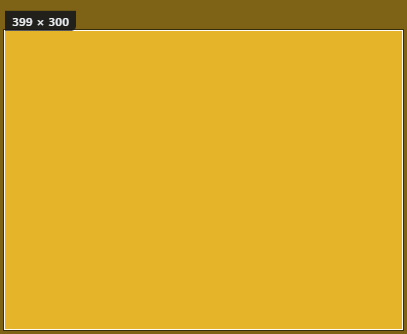

# P1 自建截图全流程实验报告（热键 → 冻结覆盖层 → 框选 → 上栏）

- **任务**：Task 16「自建截图全流程（热键 → 冻结覆盖层 → 框选 → 上栏）」
- **分支 / 基线**：`feat/core`，基线 `f0ed4a5`；实现提交 `950ce0c`（裁剪/落盘核心）、`bfdda2b`（热键/托盘接线）、`b3160e6`（覆盖层前端）、`4e111ca`（首轮运行时修复）、`09c418e`（首轮证据），**T16 review 修复提交见 `git log` 的 `fix: hotkey off main thread, capture ownership and reveal suspension (T16 review)`**。
- **日期**：2026-11-02（首轮证据本地 11:53–11:55；review 证据本地 12:46–12:50，均 UTC+8；应用日志时间戳为 UTC）
- **结论**：**程序化判据全部 PASS**（含 T16 review 的 3 个阻断项修复后复验）。
  - 首轮（会话解锁）：`request_capture` 在对应物理坐标创建 3840×1080、原点 `(-1920, 0)` 的覆盖层；负 x/150% 副屏框选 399×300 物理像素落盘 PNG 尺寸/像素精确一致（中性测试窗口颜色）；条目 `kind=capture` 上栏；目录 watcher 不重复上栏；面板隐藏后恢复；Esc 取消无副作用；同秒重名 `-2` 后缀两文件都保留。
  - Review 复验（会话锁屏，见 §2.1）：真实全局热键处理线程路径不再死锁（WM_HOTKEY 投递到 `hangline.exe` 内 `global_hotkey_app` 窗口 → handler → worker → 覆盖层；日志显示约 2 s 后 `capture-ready`，CDP 探针在 4.4 s 的步骤间隔处记录到覆盖层就绪，`hotkeyReadyMs=4422` 是探针间隔而非 ready 延迟，见 §3 #11/§6.5）；覆盖层**无边框**（客户区矩形 == 窗口矩形）、置顶、可聚焦，覆盖整屏；覆盖层期间 watcher 新条目 `reveal-request` 被挂起（面板保持隐藏），Esc 取消后**先清理再恢复**并 flush 挂起的 newItem reveal；`devicePixelRatio` 与实际 CSS viewport 不一致时用视口比例换算修复（见 §6.4）。
  - **真实物理键盘**：review 证据阶段本机被锁屏（LogonUI 拥有输入），`keybd_event` 无法送达应用桌面；因此用“投递 OS 同款 WM_HOTKEY 到插件窗口”验证 handler 线程路径，真实物理按键仍为 MANUAL-PENDING。

> **证据口径**：本文件区分【运行观察】与【单元测试/接线】；未跑过的项不写成已观察。所有提交的证据图只含中性测试窗口区域或应用窗口自身内容（§4.1），冻结帧全图从不提交。

## 1. 目的与范围

验证 Task 16 实现（设计文档 §3.1 `Ctrl+Alt+S`、§3.2 A 自建截图链路、§3.3 面板几何、§3.9 多屏 DPI、§4.6 C 截图落点、§4.8 目录）：

1. `request_capture()`：重入保护 → **经 reveal 控制器挂起并隐藏面板** → 等 `IsWindowVisible` 为 false（超时则失败而不是抓一张带线的图）→ 只读一次虚拟屏矩形 → GDI 抓屏 → 冻结帧原子写入 `%LOCALAPPDATA%\Hangline\capture-tmp.png`（asset scope 内）→ 创建覆盖整个虚拟屏幕的物理像素 `capture` WebviewWindow → 前端 ready 握手后发 `capture-ready`；
2. 覆盖层前端：`physical virtual rect ÷ CSS viewport` 得到真实 CSS↔物理比例渲染冻结帧（不假设 100%，也不盲信 `devicePixelRatio`）、暗色遮罩、拖框归一化、物理尺寸标签、松开确认、Esc/右键取消、误点击不落盘、监听器清理；
3. `finish_capture(physicalRect)`：裁剪（负原点/越界钳制）→ 原子预留文件名 + Task 8 落盘契约（`<final>.png.tmp` → 精确字节 BLAKE3-64 → `Deduper::remember` → rename → `add_item` + `emit_state`）→ **先清理再恢复 reveal 控制器**（恢复可见性与挂起的 tuck deadline，随后跑 newItem peek）；
4. `cancel_capture()`：无文件、无条目、恢复并 flush 挂起 reveal；
5. 热键/托盘接线：`Ctrl+Alt+S` 与托盘「截图…」都只把请求交给**命名 worker 线程**（绝不在 global-shortcut/event-loop 线程建窗）；
6. 同秒重名后缀（`create_new` 预留，避免与 clipboard 并发覆盖）与目录 watcher 去重（spec §3.2 规则 2）；
7. review 补强：ownership generation、reveal 挂起、ready 握手重试、面板隐藏失败中止、单次虚拟屏读取、启动清理 crash 残留、原生错误提示。

不在本任务：卡片右键菜单、标注/裁剪/全屏抑制（V1.1/P4）、真实物理键鼠手感。

## 2. 环境与运行方式

| 项 | 值 |
| --- | --- |
| OS | Microsoft Windows 11 家庭版中文版，10.0.26300 |
| Rust | rustc 1.90.0 / cargo 1.90.0 |
| App | Hangline 0.1.0（debug，`cargo build --manifest-path src-tauri/Cargo.toml`） |
| 前端 | Vite 7.3.7 dev server（`http://127.0.0.1:5173`） |
| 显示器 | `\\.\DISPLAY1` 1920×1080 @150%（物理 `x = -1920`，非主屏）；`\\.\DISPLAY2` 1920×1080 @100% 主屏；虚拟屏幕 `(-1920, 0)` 3840×1080 |
| 观测 | 进程 stdout 重定向日志（UTC 时间戳）、WebView2 CDP（`--remote-debugging-port=9222`）、Win32 `FindWindow`/`GetWindowRect`/`GetClientRect`/`ClientToScreen`/`GetWindowLongPtr`/`IsWindowVisible`（PMv2 探针进程）、System.Drawing 像素探针 |

**运行方式（沿用 Task 2/5/7/8/10/11/15 的沙箱 workaround）**：

1. `pnpm dev` 启动 Vite；
2. `cargo build` 后把 `src-tauri/target/debug/hangline.exe` 复制到 `%TEMP%\hangline-t16\hangline.exe`；
3. `WEBVIEW2_ADDITIONAL_BROWSER_ARGUMENTS=--remote-debugging-port=9222 --remote-allow-origins=*` 启动副本；
4. 中性内容来源：Per-Monitor-V2 WinForms 助手进程在物理 `(-1920, 0)` 放一个 1920×1080 无边框窗口（深蓝底 + `1000×600` 纯色 `230,180,40` label）。所有框选都落在该纯色 label 内，因此截图/冻结帧证据只含测试颜色；
5. CDP `Runtime.evaluate` 调命令、`Input.dispatchMouseEvent` 产生真实 DOM 指针事件、`Input.dispatchKeyEvent` 发 Esc、`Page.captureScreenshot` 抓覆盖层；
6. 面板显示：启动第二个 app 进程触发单实例 toggle（真实 reveal 路径）。

### 2.1 Review 证据轮的锁屏约束

收集 review 修复证据时，Windows 会话被真人**锁屏**（`LogonUI` 运行、前台为「Windows 默认锁屏界面」）。锁屏后：

- CDP 命令、窗口创建、watch/controller 逻辑、文件落盘、Win32 窗口探针全部正常工作（本文件 review 证据均在此状态下取得）；
- `keybd_event`/`SendInput` 的按键进入锁屏桌面，**无法触发应用注册的全局热键**（实测本机 `RegisterHotKey` helper 也收不到注入键；`SetCursorPos` 仍有效，说明是锁屏输入桌面隔离而非 API 权限问题）；
- 因此 review 轮用**投递 OS 同款 `WM_HOTKEY`** 到 `hangline.exe` 内 global-hotkey 的真实隐藏窗口（`global_hotkey_app`，先校验 pid 属于 hangline.exe）来验证「插件 dispatch → handler 线程 → worker → 建窗」路径；这覆盖了 review 指出的死锁根因，但不等于真实键盘输入。
- 真实物理键盘 / `keybd_event` 热键路径（解锁桌面下）仍记录为 MANUAL-PENDING（§7）。

## 3. 预期 vs 观察

| # | 项 | 预期 | 观察 | 结论 |
| --- | --- | --- | --- | --- |
| 1 | 覆盖层窗口几何/样式（负原点） | 无边框/置顶/可聚焦，覆盖整个虚拟屏幕物理像素 `(-1920,0) 3840×1080` | Win32 探针（review 轮）：`Hangline capture` `visible=true rect={x:-1920,y:0,w:3840,h:1080}`，`client` 同矩形且 `framed=false`（无标题栏/边框的非客户区）；`exStyle.topmost=true`、`exStyle.noActivate=false`（可聚焦）；同一时刻面板 `visible=false`。首轮同矩形。注：TAO 的无边框窗口仍保留 `WS_CAPTION` 样式位，因此以「客户区==窗口矩形」而非样式位判断无边框 | PASS【运行观察】 |
| 2 | 冻结帧渲染 | asset protocol 加载 `capture-tmp.png`；CSS 尺寸与真实视口比例一致 | 首轮（解锁）：`img.natural=3840×1080`、`client=3840×1080`、`innerWidth/Height=3840×1080`，`devicePixelRatio=1`；review 轮（锁屏）：`dpr=1` 但 `innerWidth=2560×720`，派生 scale `1.5000`，`img.client=2560×720`（铺满视口、无裁切），见 §6.4 | PASS【运行观察】 |
| 3 | CSS↔物理换算（不假设 100%） | CSS 框选矩形 × 真实比例 + 虚拟原点 = 物理矩形 | 首轮：CSS `(222,99) 399×300` → 日志 `confirm CSS 222,99 399x300 -> physical -1698,99 399x300`，落盘 399×300 且像素全为中性的 `230,180,40`。换算依据是 `physical virtualRect ÷ CSS viewport`（首轮 3840/3840=1；review 轮 3840/2560=1.5），`devicePixelRatio` 只作兜底；`innerWidth/innerHeight` 与冻结帧物理尺寸的 1:1（首轮）是映射正确的直接证据 | PASS【运行观察】 |
| 4 | 负 x/150% 副屏内容 | 落盘像素来自该物理区域（中性助手窗口） | 首轮保存 PNG 399×300，采样 13 300 像素**唯一颜色** `230,180,40`（= 助手 label 纯色）；同区域独立 `GetPixel` 为 `0x0028B4E6`（同色） | PASS【运行观察】 |
| 5 | 上栏 + revision + 新条目 reveal | `ItemKind::Capture`、宽高=裁剪尺寸、`add_item`+`emit_state`、`revealOnNew` 时 newItem peek（在清理之后） | 首轮（**修复前代码**，运行观察）：`revision=1`，`items[0]={kind:"capture",width:399,height:300}`，日志 `capture: hung … (Capture) 399x300`。review 轮**只运行了取消路径**（revision 1→1），没有运行修复后的 finish 路径；因此「`hung` → 清理 → `reveal: capture ended` → newItem peek」这一**修复后顺序未在运行时复验**，仅由代码与 §5.1 的 capture-gate/resume 单测覆盖 | PASS（首轮上栏 + 单测）；修复后 finish 顺序：**未复验** |
| 6 | 临时冻结帧清理 | 完成后删除 `capture-tmp.png` | 完成/取消后 `tempExists=false`；启动时还会清理上次崩溃残留（`remove_stale_frozen_frame`） | PASS【运行观察】 |
| 7 | 目录 watcher 不重复上栏 | 认领哈希/路径去重；5 s 内同文件不再上栏 | 首轮 +2.6 s 后 revision 不变、同 path item 数 1；日志 `watchers: ignored … (already hung on the line)` | PASS【运行观察】 |
| 8 | 面板可见性/挂起 | 抓屏前经 reveal 控制器隐藏；完成后恢复；pending tuck deadline 不丢失 | review 轮日志：`reveal: capture suspend at +26446 ms (was_visible=true, pending hide deadline None)` → `panel: hidden`；完成后 `reveal: capture ended ... (was_visible=true, ...)` → `panel: shown`；探针覆盖层期间 `visible=false`、取消后 `visible=true` | PASS【运行观察】 |
| 9 | 覆盖层期间其他 reveal 路径 | watcher newItem/toggle/top-edge 被抑制或挂起；面板不得出现在冻结画面上 | review 轮：覆盖层期间复制一个中性 PNG 进自有目录 → watcher 上栏（revision 1）并触发 `reveal-request`；日志 `reveal: new-item request deferred while the capture overlay is open`；探针面板 `visible=false`；Esc 取消后日志 `reveal: capture ended ... (deferred_new_item=true, request_new_item=false)` → `panel: shown`（挂起 reveal 在清理后 flush） | PASS【运行观察】 |
| 10 | Esc 取消 | 销毁窗口、删除临时图、恢复面板；无文件无条目 | review 轮：控制台 `Hangline capture: cancelled (Esc/right click)`；日志 `capture: cancelled; no item or file was created`；`revision` 1→1、`items.length` 1（覆盖层期间 watcher 条目）、`tempExists=false`；取消前探针 `Hangline capture visible=true rect=(-1920,0,3840,1080)`，取消后探针 `Hangline capture found=false`；面板 `visible=true` | PASS【运行观察】 |
| 11 | 热键 handler 线程 | handler 不得在 event-loop 线程建窗；应转交 worker | review 轮：向 `global_hotkey_app`（pid 属于 hangline.exe）投递 WM_HOTKEY（Ctrl+Alt+S id 589861）→ 日志 `hotkeys: capture requested (dispatching to the capture worker thread)`；日志时间 `capture suspend` 04:50:04 → `froze`/`capture-ready` 04:50:06（**约 2 s**）→ 覆盖层就绪，无死锁。CDP 记录的 `hotkeyReadyMs=4422` 是探针步骤间隔（「hotkey-delivery」04:50:04.600 → 「hotkey-capture-overlay」04:50:08.947，含脚本轮询开销），**不是** ready 延迟 | PASS【运行观察，注入方式见 §2.1；真实物理键盘 MANUAL-PENDING】 |
| 12 | 重入/所有权 | 覆盖层打开时再次请求不产生第二窗口；旧请求的清理不得清掉新请求 | 控制器相位机 + generation ownership 单测：stray cancel during Freezing no-op、stale owner 的 abort/release 不影响新会话、session 恰好取一次、`Overlay` 缺 session 时重置 Idle（§5.1） | PASS【单元测试】+ 接线 |
| 13 | 误点击不落盘 | pointerdown/up 无拖动（<2 CSS px）不确认 | 单元测试 `isSelectionLargeEnough`；早期实测日志 `click without a real drag ignored` 是已修复缺陷（先清空起点）的表现，review 修复后正常拖拽不再被误判 | PASS（单测） |
| 14 | 同秒重名后缀 | 已占用名字 → `-2` 后缀；两个文件都保留 | 首轮运行时：覆盖层期间创建 7 个占位目录，落盘 `…11.54.37-2.png`，占位目录与新 PNG 都在；`create_new` 原子预留的并发/TOCTOU 单测见 §5.1 | PASS【运行观察 + 单测】 |
| 15 | review 修复 | Critical/Important/minors 全部落地 | 见 §10 | PASS |
| 16 | 真实物理热键 / 真人拖框 / 跨屏接缝 | 键盘 `Ctrl+Alt+S`、真人鼠标框选、跨 150%↔100% 接缝一次框选 | 锁屏期间无法注入真实按键；真人拖框在首轮证据前的自由操作中出现过（已删除，未作证据）；跨接缝未运行 | **MANUAL-PENDING** |

## 4. 证据

### 4.1 截图范围与隐私约束（重要）

- 覆盖层覆盖整块虚拟屏幕，冻结帧包含桌面内容，**不提交任何全屏/冻结帧截图**。
- `P1-capture-overlay-selection-150pct.png` = CDP `Page.captureScreenshot` 覆盖层截图裁剪（框选矩形 + 上方 26 px 尺寸标签区）。裁剪区域全部位于中性助手窗口的纯色 label 内（物理 `-1920..-920 × 0..600`）。
- 该 PNG 全图共有 **127 种唯一颜色**（step-1 全像素统计）：主导色为 `230,180,40`（118 306 px，选区）、`126,99,22`（13 487 px，45% 遮罩下的同色）、`57,45,10`（1 332 px，标签底板）、`254,251,244`（1 325 px，标签文字），其余为标签文字 ClearType/抗锯齿与 1 px 边框混色产生的黄色/中性灰过渡色（例如 `33,32,27`、`108,87,22`、`25,25,25`、`88,88,89`），**全部是该中性色板的明暗变体，不含桌面/其他应用内容**。（首轮报告曾粗略写成“只有 4 种颜色”，review 更正为 127 种并给出主导色构成。）
- **“399 × 300”与 127 色的口径区分**：127 色统计针对上面这张 **407×334 的覆盖层裁剪图**；“399×300”是应用实际落盘 PNG 的尺寸。落盘图（`P1-capture-saved-selection-150pct.png`）为 **119 700 px 全为同一种 `230,180,40`（唯一色数 = 1）** 的单色图，不含文字/遮罩/边框混色，不能用 127 色描述它。
- 冻结帧全图、覆盖层全屏截图只存在于 `%TEMP%\hangline-t16\out\`，实验结束随临时目录删除；review 轮新增的证据 JSON 不含任何截图内容。

### 4.2 证据文件

| 文件 | 尺寸/大小 | SHA-256 | 说明 |
| --- | --- | --- | --- |
| `P1-capture-overlay-selection-150pct.png` | 407×334 | `60B897E0…E3D03` | 覆盖层截图裁剪：白色选区边框、“399 × 300” 物理尺寸标签、遮罩下的中性黄色（127 色，见 §4.1） |
| `P1-capture-saved-selection-150pct.png` | 399×300 | `2C04CDEE…435A5` | 应用实际落盘的 PNG 副本：全部采样像素 `230,180,40`（唯一色数 = 1，见 §4.1），对应负 x/150% 副屏的助手 label；review 轮作为「覆盖层期间 watcher 新条目」的中性输入复用 |
| `P1-capture-runtime.json` | 9 295 B | `0A0580A0…3CC87` | 首轮（解锁）CDP/Win32 证据：覆盖层几何/DPI、拖拽 CSS/物理矩形、item/revision、watcher、取消、同秒后缀 |
| `P1-capture-review-runtime.json` | 9 131 B | `A0E0385A…4EAB` | review 轮（锁屏）证据：WM_HOTKEY 投递、handler/worker、覆盖层 client/framed/topmost/focusable、真实视口 scale `1.5000`、覆盖层期间 defer reveal、Esc 取消后恢复与 flush |




### 4.3 关键运行日志（进程 stdout，UTC）

首轮（解锁，CDP invoke 命令路径；以下为**修复前代码的实测原文**，提交 `09c418e` 时记录。`hiding the line` / `restored the line` 是当时的日志文案，review 修复后已改为 `reveal: capture suspend/ended`）：

```text
[03:54:03][hangline_lib::capture][INFO] capture: hiding the line before the freeze (CAPTUREBLT would include it)
[03:54:03][hangline_lib::panel][DEBUG] panel: hidden
[03:54:06][hangline_lib::capture][INFO] capture: froze 3840x1080 px at (-1920, 0) into %USERPROFILE%\AppData\Local\Hangline\capture-tmp.png
[03:54:06][hangline_lib::capture][INFO] capture: overlay shown at (-1920, 0) 3840x1080 px (scale 1.500, line was visible)
[03:54:06][hangline_lib::capture][INFO] capture: capture-ready (3840x1080 px frozen frame, scale 1.500)
[03:54:07][hangline_lib::capture][INFO] capture: hung …\Hangline 2026-11-02 11.54.07.png (Capture) 399x300 hash 60ed2cff8a618f01
[03:54:07][hangline_lib::capture][DEBUG] capture: removed the frozen frame …\capture-tmp.png
[03:54:07][hangline_lib::panel][DEBUG] panel: shown
[03:54:07][hangline_lib::capture][INFO] capture: restored the line (it was visible before the freeze)
[03:54:07][hangline_lib::watchers::dirs][INFO] watchers: ignored …\Hangline 2026-11-02 11.54.07.png (already hung on the line)
```

> **口径说明**：上面是修复前的历史原文，**不能**当作修复后行为的证据；修复后 `finish_capture` 走「清理后再由 reveal 控制器 resume」的顺序，该顺序**没有**在 review 轮运行（review 轮只跑了取消），仅有代码与单测覆盖（§3 #5、§5.1）。

review 轮（锁屏，WM_HOTKEY → handler → worker → 挂起 → 取消；以下节选去掉了日期前缀，行序按仓库提交的 `P1-capture-review-runtime.json` 的 `logLines` 校正，JSON 为该轮原始证据）：

```text
[04:50:04][hangline_lib::hotkeys][INFO] hotkeys: capture requested (dispatching to the capture worker thread)
[04:50:04][hangline_lib::panel][DEBUG] panel: hidden
[04:50:04][hangline_lib::reveal][INFO] reveal: capture suspend at +26446 ms (was_visible=true, pending hide deadline None); line hidden, other reveal paths suppressed
[04:50:04][hangline_lib::capture][INFO] capture: suspended the line before the freeze (CAPTUREBLT would include it, was_visible=true)
[04:50:06][hangline_lib::capture][INFO] capture: froze 3840x1080 px at (-1920, 0) into …\capture-tmp.png
[04:50:06][hangline_lib::capture][INFO] capture: overlay shown at (-1920, 0) 3840x1080 px (scale 1.500)
[04:50:06][hangline_lib::capture][INFO] capture: capture-ready (3840x1080 px frozen frame, scale 1.500)
[04:50:10][hangline_lib::reveal][INFO] reveal: new-item request deferred while the capture overlay is open (+32686 ms)
[04:50:13][hangline_lib::capture][DEBUG] capture: removed the frozen frame …\capture-tmp.png
[04:50:13][hangline_lib::capture][INFO] capture: cancelled; no item or file was created
[04:50:13][hangline_lib::reveal][INFO] reveal: capture ended at +35841 ms (was_visible=true, pending hide deadline None, deferred_new_item=true, request_new_item=false)
[04:50:13][hangline_lib::panel][DEBUG] panel: shown
[04:50:13][hangline_lib::capture][DEBUG] capture: overlay window destroyed after the session was already handled
```

前端控制台（CDP，review 轮）：`Hangline capture: frozen frame 3840x1080 px at (-1920, 0), scale 1.5`、`Hangline capture: viewport scale 1.5000 (physical 3840 px / CSS viewport 2560 px)`、`Hangline capture: cancelled (Esc/right click)`。

## 5. 单元测试与质量闸门

### 5.1 TDD（RED → GREEN）与 review 增补测试

- Rust（RED）：先加 11 个测试后 `cargo test capture::tests` 编译失败（`cannot find function save_capture_image_at`、`use of undeclared type CaptureCoordinator` 等 27 errors）；实现后 GREEN。
- 前端（RED）：`selection.test.ts` 先失败 `Cannot find module './selection'`；实现后 GREEN。
- review 增补（全部先失败/先断言行为，再实现）：
  - `a_stale_request_cannot_wipe_a_newer_capture`：stray cancel during `Freezing` 为 no-op；旧请求的 abort/release 不影响新 generation 的 session/phase；
  - `the_coordinator_blocks_reentry_with_an_owned_lease`、`cancel_only_takes_a_live_overlay_and_releases_its_owner`、`a_missing_overlay_session_resets_to_idle_instead_of_blocking_captures`；
  - `own_capture_claims_the_exact_file_hash_before_the_rename` 现在用 step observer 断言顺序 `Reserved → TmpWritten → Hashed → Claimed → Renamed`，并断言 claim 时最终名仍为空预留、内容字节不可见；
  - `reservation_never_replaces_a_concurrent_file`、`concurrent_same_second_saves_reserve_distinct_names`（8 线程同秒保存 → 8 个不同名字、无 `.tmp` 残留、哈希=落盘字节）；
  - `stale_frozen_frames_are_removed_only_when_present`；
  - reveal：`capture_gate_records_and_resumes_the_pre_capture_visibility_once`、`capture_gate_only_defers_new_items_while_active`、`resume_restores_the_pending_tuck_deadline_only_when_the_line_was_visible`（4 种 deadline 决策）；
  - 前端：`toPhysicalRect` 逐边取整 + 相邻选区无缝拼接测试、`viewportScale`（3840/3840=1、3840/2560=1.5、视口不可测时回落 `devicePixelRatio`）。
- 首轮测试覆盖（裁剪负原点/越界、claim 顺序、同秒后缀、重入、payload wire 契约、asset-scope 临时路径）保持不变；测试目录改为 `fresh_test_dir`（先删后建），精确文件名断言不再受上次运行残留影响。

### 5.2 闸门（最终提交前实测）

| 命令 | 结果 |
| --- | --- |
| `cargo test --manifest-path src-tauri/Cargo.toml` | **208 tests：203 passed, 0 failed, 5 ignored**（5 ignored = 2 个 Task 5 E5 双屏环境测试 + 3 个 OLE 拖拽证据测试，均需交互桌面/真实双屏） |
| `cargo check --manifest-path src-tauri/Cargo.toml --all-targets` | Finished，**0 warnings** |
| `pnpm check` | exit 0：eslint + tsc + **vitest 72 passed / 11 files** + i18n（18 keys）+ version 全绿 |
| `git status --short` | 提交后 clean |

## 6. 偏差、发现与关注点

### 6.1 review Critical：热键 handler 不得在主线程建窗

`handle_action(Target::Capture)` 不再直接调用 `request_capture`：global-shortcut 插件在 event-loop 线程分发 handler，而 `WebviewWindowBuilder::build` 会向 event loop 派发并等待 → 死锁（首轮只经 async command 路径验证，未覆盖热键路径）。现在 hotkey/tray 都调用 `capture::request_capture_in_background`（命名 worker `hangline-capture`），async command 仍走 tokio worker。review 轮用 WM_HOTKEY 投递到 `global_hotkey_app` 窗口验证了 handler→worker→覆盖层无死锁；**真实物理键盘/解锁桌面的 `keybd_event` 仍 MANUAL-PENDING**（§2.1）。

### 6.2 review Important 1：capture 所有权竞态

引入 `CaptureLease { generation }`：`try_begin` 递增 generation；`attach_overlay`/`abort_owned`/`release_owned` 仅对 owning generation 生效；`take_for_cancel` 只允许 `Overlay` 相位（`Freezing` 的 stray cancel 为 no-op，也不销毁不属于它的窗口）；`take_for_finish` 在 `Overlay` 却无 session 时重置为 `Idle`。旧实现的 `release()` 无条件清 session、cancel 无 session 时销毁窗口的路径已删除。

### 6.3 review Important 2：capture 绕过 reveal 控制器

`capture.rs` 不再直接 `panel::hide/show`：新增 reveal 控制器的 capture 挂起（`CaptureGate`）。`suspend_for_capture` 阻塞等待控制器隐藏并记录 `was_visible` + 挂起的 tuck deadline；覆盖层期间 NewItem 被 defer（最多一条）、Toggle 被抑制、top-edge/hide-deadline/tick 全部跳过；`resume_after_capture` 在**覆盖层销毁之后**恢复可见性（`resume_hide_plan`：未来 deadline 保留、已过期保持隐藏）并 flush 挂起/自身 newItem。`finish_capture` 的 reveal 也在 cleanup 之后由控制器执行，不再有“面板压在冻结画面上”的窗口。运行时 probe 见 §3 #9/#10。

### 6.4 review 发现：WebView2 `devicePixelRatio` 与实际缩放不一致

review 轮（锁屏 + 跨屏窗口）页面 `devicePixelRatio=1`，但物理 3840 px 窗口的 CSS viewport 只有 2560 px（真实比例 1.5），若仍按 dpr 换算，框选会错位/裁错区域。修复：前端用 `viewportScale = virtualRect.w / window.innerWidth`（真实物理/CSS 比例）为主、`devicePixelRatio` 仅兜底；冻结帧按该比例铺满视口（review 轮 `img.client=2560×720 == viewport`，`data-css-scale=1.5000`）。首轮解锁状态该值为 1（3840/3840），既有 399×300 证据仍成立。该修复同时满足 brief 的“不假设 100%”。

### 6.5 时序：ready 延迟来自原生冻结+PNG 编码（debug），不全是 Vite

review 轮日志：`capture suspend` 04:50:04 → `froze`/`capture-ready` 04:50:06（**约 2 s**，3840×1080 PNG 在 debug 构建的 GDI 抓取+编码+落盘）→ 覆盖层就绪，handler→worker 建窗发生在同一秒内。CDP 证据里的 `hotkeyReadyMs=4422` 是探针步骤间隔（「hotkey-delivery」04:50:04.600 → 「hotkey-capture-overlay」04:50:08.947，含脚本轮询开销），**不是**从热键到 ready 的延迟——此前把它当作 ready 耗时属于错误归因。首轮 `readyMs=3829` 同量级，也主要是原生冻结/编码（debug 构建）+ 覆盖层 webview 页面加载（dev Vite ~0.8 s）；首轮报告把 2.5–4 s 主要归因于 Vite 不准确，此处更正；release 构建的原生编码会明显更快。

### 6.6 面板隐藏失败改为中止

`wait_until_panel_hidden` 用直接 Win32 `IsWindowVisible`（不阻塞 event loop）轮询；若 240 ms 后仍可见或无窗口句柄，**中止本次截图**（释放 guard、恢复 reveal、显示原生错误框），而不是把带面板的画面冻结进截图。

### 6.7 ready 握手竞态

前端注册 `capture-ready` 后以 `[0,100,200,400,800,1200,1600] ms` 退避重试 `report_capture_ready`；Rust 侧 `report_overlay_ready` 也最多等 3 s 直到 session attach 再 emit（`OVERLAY_ATTACH_WAIT`）。若全部失败，前端主动 `cancel_capture` 关闭黑屏覆盖层，不会无声卡死。

### 6.8 文件名 TOCTOU 与 crash 残留

`save_capture_image` 先用 `OpenOptions::create_new` **原子预留**最终名（`create_new` 失败则试下一个 `-N`/毫秒名），再写 tmp→哈希→remember→rename 覆盖自己的空预留；失败路径删除预留与 tmp 并 `forget(hash)`。这样 clipboard 并发保存同一秒的名字不会被 rename 静默覆盖（并发单测）。启动时 `remove_stale_frozen_frame` 删除上次崩溃留下的 `capture-tmp.png`；`finish_capture`/`request_capture` 失败会用原生 `MessageBoxW` 提示（spec §3.11），不再只写日志。

### 6.9 同秒冲突的运行时证法

CDP/自动化无法在真实“同一秒”内完成两次完整框选，因此首轮运行时用**目录占位**阻塞 plain 文件名（目录通过 `Path::exists()` 但不是候选文件），落盘得到 `-2` 且两个“文件”都在；真实两次同秒保存的语义由 `same_second_captures_are_both_kept_with_a_numbered_suffix` 与并发/TOCTOU 单测覆盖。

### 6.10 其他

- 覆盖层无文字 UI（仅 `W × H` 数字），避免新增 i18n key；Esc/右键为约定交互。
- 锁屏/DRM 内容：GDI 截屏在锁屏下副屏为黑、DRM 窗口可能黑屏（OS 限制，见 `P0-E5.md`）。
- 共用桌面：证据阶段存在真人操作/指针漂移；首轮曾两次被真人拖进覆盖层落盘（文件已删除，未作证据）；正式 run 尽量缩短覆盖层交互窗口。
- 覆盖层显示期间若 `Ready/ReadyTimeout` 恰在启动初期到达，controller 会消费握手但跳过 startup reveal，避免在冻结画面上显示面板（极端场景，review 记录）。

## 7. MANUAL-PENDING（Task 17 汇总）

1. **真实物理键盘 `Ctrl+Alt+S`**（解锁桌面）：review 轮锁屏导致 `keybd_event` 无法送达；已用 WM_HOTKEY 投递验证 handler→worker 路径，真实按键建议人工按一次（同时确认无死锁）。
2. **真人鼠标框选/手感**：遮罩、尺寸标签、Esc/右键、误点击行为由合成指针 + 单测验证；真人手感与松手闪烁需人工确认。
3. **跨屏一次框选（横跨 `x=0` 接缝）**：`crop_virtual` 数学有负原点/越界单测，真人在 150%+100% 接缝处的视觉/尺寸标签仍需人工。
4. **DRM/受保护窗口**：GDI 截屏为黑（OS 限制，spec §5 已记录），未用真实 DRM 内容验证。
5. **顶部/上方显示器、顶部/侧边任务栏**：本机无此硬件。
6. **多显示器热插拔中途打开覆盖层**：会话固定 `virtual_rect` 裁剪，显示变化场景未实测。

## 8. 清理记录

- 新增测试产物（自有 `Screenshots` 下的 `Hangline 2026-11-02*` 捕获、`Hangline review *` 中性输入文件、占位目录）已删除；原有 `Hangline 2026-10-29 *.png` 与 `probe.txt` 保留。
- `state.json`（测试产生）已删除；`settings.json` SHA-256 与测试前一致：`8E315C7B…A79089`（未改任何设置）。
- `%LOCALAPPDATA%\app.hangline.Hangline\logs\Hangline.log` 恢复为测试前备份（11 376 B）。
- `capture-tmp.png` 已删除；app/Vite/中性助手进程停止；`%TEMP%\hangline-t16*` 临时目录删除。
- 未修改 `docs/superpowers/specs/`、`docs/superpowers/plans/`；`.superpowers/` 仅本任务报告。

## 9. 关键命令

```powershell
# 测试/闸门
cargo test --manifest-path src-tauri/Cargo.toml
cargo check --manifest-path src-tauri/Cargo.toml --all-targets
pnpm check

# 运行时（沙箱等价方式；正常桌面直接 pnpm tauri dev）
pnpm dev
cargo build --manifest-path src-tauri/Cargo.toml
Copy-Item src-tauri\target\debug\hangline.exe $env:TEMP\hangline-t16\hangline.exe
$env:WEBVIEW2_ADDITIONAL_BROWSER_ARGUMENTS='--remote-debugging-port=9222 --remote-allow-origins=*'
& $env:TEMP\hangline-t16\hangline.exe
```

## 10. T16 Review 修复记录（2026-11-02）

| 项 | 修复 | 证据 |
| --- | --- | --- |
| **Critical**：热键在 event-loop 线程建窗 | `handle_action`/托盘改为 `capture::request_capture_in_background`（命名 worker）；async command 保持 tokio 路径 | review 轮 WM_HOTKEY 投递 → `hotkeys: capture requested (dispatching to the capture worker thread)` → 日志约 2 s 后 `capture-ready`（CDP 探针 4.4 s 步骤间隔处观测到覆盖层），无死锁；单测 hotkey 归一化不变 |
| **Important 1**：reentry 所有权竞态 | `CaptureLease` generation：owner-checked attach/abort/release；cancel 仅 `Overlay`；defensive `Idle` reset；cancel 无 session 不销毁窗口 | §5.1 的 stale-request/stale-cancel/missing-session 单测 |
| **Important 2**：capture 绕过 reveal 控制器 | `CaptureGate` + `suspend_for_capture`/`resume_after_capture`：隐藏、抑制/defer other reveal、恢复可见性/deadline、清理后 emit reveal | review 轮 defer/恢复日志 + 面板 hidden→shown probe；`capture_gate_*`/`resume_*` 单测 |
| minor：逐边取整 | `toPhysicalRect` 左右/上下边分别 round，宽度=差 | 前端 72 tests（含相邻选区无缝） |
| minor：ready 握手竞态 | 前端退避重试 + Rust 等 attach 再 emit；失败主动 cancel | 代码 + 前端测试 |
| minor：hide 失败中止 | Win32 `IsWindowVisible` 轮询超时→中止并恢复 | 代码路径 + 错误框 |
| minor：单次虚拟屏读取 / 帧尺寸 | `grab_virtual_screen_in(screen)`；前端以冻结图 `width/height` 定帧尺寸 | 代码 + E5 测试保持 |
| minor：crash 残留 / 失败反馈 | `remove_stale_frozen_frame` 启动清理；`MessageBoxW` 原生错误框 | 代码 + stale 单测 |
| minor：同秒 TOCTOU | `create_new` 原子预留 + 重试/毫秒回落；失败清理预留 | `reservation_never_replaces_a_concurrent_file`、8 线程并发单测 |
| minor：测试健壮性 | step observer 断言 remember-before-rename；`fresh_test_dir` | §5.1 |
| minor：证据更正 | 127 色统计、取消前/后探针区分、时序归因、probe 范围、1:1 映射证据 | 本文件 §3/§4/§6 |
| 追加发现 | WebView2 `devicePixelRatio` 与真实 viewport 比例不一致 | `viewportScale` + 前端测试 + review 轮 `data-css-scale=1.5000` |
