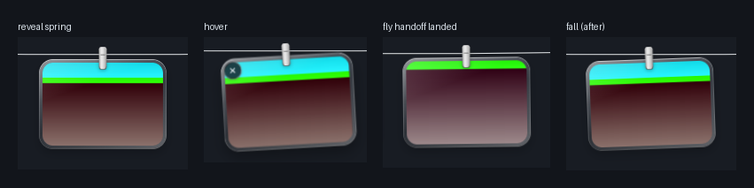

# P2 视觉/运动帧对比（P2-9）

- **任务**：P2-9 帧对比（计划 Task P2-9 Step 4）
- **环境**：Windows 11；主屏 1920×1080 @100%，虚拟屏 3840×1080；WebView2 156；debug 二进制（`cargo build`）+ `pnpm dev` + **隔离 `%LOCALAPPDATA%`**；12 张 4K 源图（3840×2160）+ P2-7 缩略图；卡片 medium、keep=fit（面板 1920 dp 宽时容量 9，因此 12 个 item 中同时可见 9 张）。
- **方法**：`scripts/p2/compare.mjs` 通过 CDP 在 panel/fly 两个 webview 打开 `window.__HANG_TRACE_ON__`，触发真实动画后读取面板/卡片/overlay 的逐帧 trace（`src/lib/trace.ts`，~16 ms 采样）。tuck 的 220 ms 是 CSS transition，已由 `Panel.tuck()` 内新增的逐 rAF `tuck` 采样覆盖（不再依赖 OS 光标）。
- **参考素材**：Tendedero 参考实现与演示 GIF 仅以 fair-use 方式保存在本地、被 `.superpowers/p2-reference/` 忽略，**未提交**；本机没有 macOS 参考录屏，因此对照对象是 `P2-reference.md` 的源码 token/演示测量数字与**实现计划中的容差带**（如 reveal 420±80 ms、tuck 220±60、fly 650±60、fall 550±60、hover 1.035–1.04），而不是逐帧同录。
- **容差出处**：`docs/superpowers/plans/2026-11-02-hangline-windows-visual-soul.md`（± 带）；`P2-reference.md` 给出 token 与演示实测值。
- **限制**：CDP 输入不是 OS 指针（Rust reveal 控制器读 `GetCursorPos`），因此**真实 hover/click-through 与指针驱动的 tuck 触发**仍需人工；单击复制 nudge 在本次 CDP 点击下未触发；所有时间值受 rAF 采样分辨率（~16 ms）影响；本页数据为 **dark 主题**（light 主题未测帧率）。

## 复现命令（PowerShell 5.1+ 可直接执行；隔离 profile，勿指向真实 `%LOCALAPPDATA%`）

> 以下命令会**重新生成**已提交的证据文件（`docs/experiments/P2-perf.json`、`P2-visual-raw.json`、`p2-frames/*`、`P2-contact-sheet.png`），不是只读检查。必须使用隔离 profile，且 `pnpm dev`（5173）必须**先**运行。

**两个终端**：终端 A 固定运行 Vite（app 的 devUrl 固定 5173），终端 B 执行下面步骤 1–7。前置：仓库已 `pnpm install`。

```powershell
# 终端 A —— 保持运行；等到输出 “Local: http://localhost:5173/”
pnpm dev
```

```powershell
# 终端 B
# 1. 预检：5173 必须已由终端 A 提供；若被旧实例占用先杀旧进程（不要在这里启动 Vite）
Get-Process hangline -ErrorAction SilentlyContinue | Stop-Process -Force
$viteOk = $false
for ($i = 0; $i -lt 120; $i++) {
  try { if ((Invoke-WebRequest "http://localhost:5173/" -UseBasicParsing -TimeoutSec 2).StatusCode -eq 200) { $viteOk = $true; break } } catch {}
  Start-Sleep -Milliseconds 500
}
if (-not $viteOk) { throw "Vite is not answering on 5173; start `pnpm dev` in terminal A first" }
Set-Location (git rev-parse --show-toplevel)

# 2. debug 二进制 + 复制到临时目录（源码里的 exe 路径不是 $base）
cargo build --manifest-path src-tauri/Cargo.toml
$base = "$env:TEMP\hangline-p2-9"
New-Item -ItemType Directory -Force $base | Out-Null
Copy-Item "src-tauri\target\debug\hangline.exe" "$base\hangline.exe" -Force

# 3. 隔离 profile + fixture（脚本生成 settings.json/state.json/Screenshots 与 12x4K card、6xaction PNG）
node scripts/p2/fixtures.mjs --profile "$base\localappdata\Hangline"
node scripts/p2/fixtures.mjs --cards "$base\cards"

# 4. 启动 app：PowerShell 5.1 兼容写法（不用 Start-Process -Environment；会话 env 会被继承）
$env:LOCALAPPDATA = "$base\localappdata"
$env:HANG_CDP_PORT = "9222"
$app = Start-Process -FilePath "$base\hangline.exe" -PassThru

# 5. 等 Vite 200 + CDP/panel ready（wait.mjs 内部有 250ms→15s 的 CDP 重试）
node scripts/p2/wait.mjs

# 6. 应用启动后【再】放 12 张 card —— watcher 没有 initial scan，启动前放置不会产生 notify 事件
node scripts/p2/fixtures.mjs --copy-cards "$base\cards" --to "$base\localappdata\Hangline\Screenshots"

# 7. 证据再生成命令（会覆盖已提交的 evidence JSON/frames/sheet；仅隔离 profile）
node scripts/p2/perf.mjs
$env:HANG_COMPARE_CARDS = "$base\cards"
$env:HANG_WATCH_DIR = "$base\localappdata\Hangline\Screenshots"
node scripts/p2/compare.mjs
# 可选：需要 Python 3 + Pillow；未安装时跳过，已提交的 contact sheet 保持
python scripts/p2/sheet.py

# 8. 清理：关闭 app，停止终端 A，删除临时目录；在【新的】shell 恢复真实 %LOCALAPPDATA%
Stop-Process -Id $app.Id -Force -ErrorAction SilentlyContinue
Remove-Item $base -Recurse -Force -ErrorAction SilentlyContinue
```

> **破坏性警告**：步骤 7 会覆盖已提交的 P2 证据文件，并向隔离 `HANG_WATCH_DIR` 写入 fixture、把 item 取下线（`deleteFile:false`，不删除源文件）。**绝不能**把 `HANG_WATCH_DIR` 指向真实用户的 `Hangline` 数据目录；完成后关闭 app 并在新 shell 恢复真实 `%LOCALAPPDATA%`。

## 1. 数值表（`docs/experiments/P2-visual-raw.json`）

| 项 | 参考容差 | 实测 | 判定 |
| --- | --- | --- | --- |
| 展开 reveal 时长 | 420 ± 80 ms | **383 ms**（translateY −220.9 → 0，33 samples） | **PASS** |
| 收起 tuck 时长 | 220 ± 60 ms | **234 ms**（translateY 0 → −222，15 samples，CSS ease-in 逐帧采样） | **PASS** |
| 入场 arrival 起始摆角/位移 | 16° / −46 px（源码 token） | 起始 **16° / −46.0 px**，峰值 16°；trace 末样本 878 ms（收敛） | **PASS**（含 P2-4 单测） |
| hover 最大 scale | 1.035–1.04 | **1.037** | **PASS** |
| press 最小 scale | 0.95（450 ms ease-in-out） | **0.95** | **PASS** |
| 复制 nudge 摆角 | ≈3° | 本次 CDP 单击未触发复制（峰值 0.58°） | **MANUAL-PENDING** |
| fly 总时长 | 650 ± 60 ms | **657 ms**（等到 k=1.0 后的 trace 首末样本） | **PASS** |
| fly 弧高 | 30 dp | **30.0 dp**（trace `arcDp` 峰值） | **PASS** |
| fly chrome 淡入 | chromeStart .35 → 1 | 峰值 **1.0** | **PASS** |
| fall 时长 | 550 ± 60 ms | **564 ms** | **PASS** |
| fall 下落 | 520 dp（k³ 加速） | **520.0 dp** | **PASS** |
| fall 倾斜/淡出 | tilt 加速 + 透明度→0 | 末采样 tilt 6.4°、opacity **0.0** | **PASS（采样口径）** |
| breeze 振幅 | 1.6–3.4° | 本次 trace 未捕获 gust 峰值（perf 期间 `breeze.observed=true`，60 fps） | **MANUAL-PENDING** |

## 2. 接触表（仅本项目自有帧）



**README 的 P2 面板截图是在中性渐变背景上合成后的纯应用 UI 截图（不含桌面内容）。**

帧来源：`docs/experiments/p2-frames/`（`reveal` = 展开后卡面；`hover` = hover/cross；`fly-landed` = 飞入落地后的卡片；`fall-after` = 坠落移除后的剩余线），由 `scripts/p2/sheet.py` 生成。

## 3. 结论

- 帧对比：**数值 PASS**（reveal 383、tuck 234、arrival 16°/−46、hover 1.037、press 0.95、fly 657 ms/30 dp、fall 564 ms/520 dp 均在容差内）。
- **MANUAL-PENDING**：真实鼠标 hover/click-through、指针驱动的 tuck 手感、Copied nudge、breeze 振幅、light 主题帧率与多显示器/150% DPI，均由 `docs/acceptance/P2-core.md` §5 人工清单覆盖。

## 4. Runbook 验证记录（2026-11-03，clean temp profile）

按上面「复现命令」逐条执行（隔离 `%TEMP%\hangline-p2-9-proof`），实际输出摘要：

```
step 4: wait.mjs            -> wait: panel ready {"frames":true,"panel":true,"ready":"complete"}
step 5: copy cards           -> fixtures: copied 12 card fixtures ... (after app start)
step 6: perf.mjs             -> verdict: avgFps PASS / p95Frame PASS / worstFrame PASS / samples PASS / stayedRevealed PASS
                               idle fpsMean=60.0006 p5=59.17 worst=17 ms samples=600
step 7: compare.mjs          -> reveal 383 ms, tuck 234 ms, hover 1.037, press 0.95,
                               fly 657 ms / 30.0 dp / chrome 1, fall 564 ms / 520 dp / opacity 0;
                               environment.items=12, screenshots relative (p2-frames/*.png)
step 8: sheet.py             -> wrote docs/experiments/P2-contact-sheet.png (870,223)
```

完整命令日志：`.superpowers/p2-evidence/p2-9-runbook-proof.log`（临时目录，未提交）。
