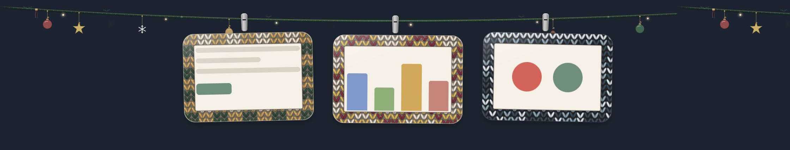
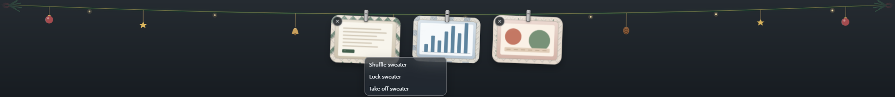
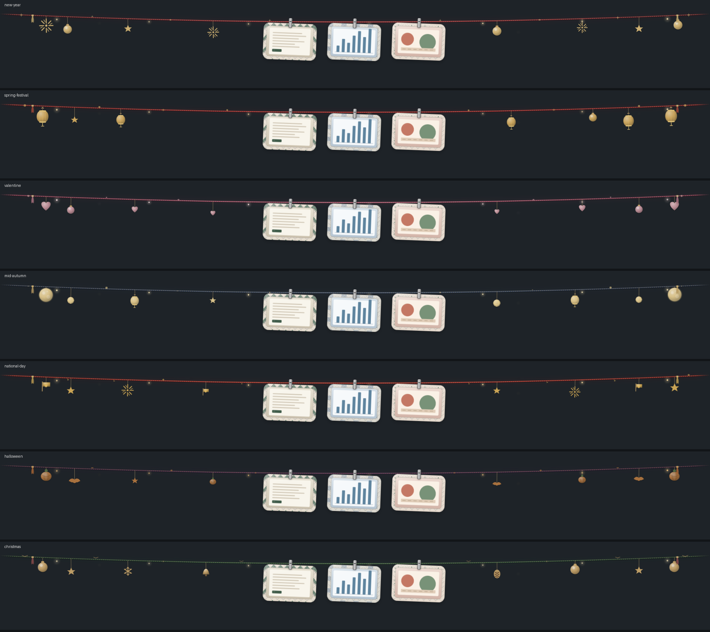

# v1.6.0 — Sweater Season + the Christmas rope

**Status:** implemented, real-machine verified, release gate in progress.
**Date:** 2026-11-16 (v1.6.1 follow-up below)
**Target:** small, local, quiet — no new network, no new window, no image modification.

## What shipped

### Sweater Season (default off)

- Tray → Appearance → **Sweater Season**. Every card gets a knitted SVG frame generated from its
  own screenshot: three colours are sampled locally from the thumbnail, softened/desaturated, then
  used as main / contrast / neutral yarn.
- Five original charts (`chevron`, `checks`, `snowflake`, `stripe`, `fairisle`), selected from a
  stable FNV-1a hash of the card id. Same card → same chart.
- Three widths: `slim` 6 dp, `classic` 9 dp (default), `chunky` 12 dp.
- Four palettes: `auto` (sample each screenshot, default), `pine`, `frost`, `berry`.
- Hover capsule gains a yarn button. Its menu offers **Shuffle sweater**, **Lock/Unlock sweater**,
  **Take off / Put on sweater**; the choice persists on the item (`state.json` → `item.sweater`).

### Per-card override contract

```jsonc
{
  "id": "…",
  "sweater": {
    "pattern": "snowflake", // optional; omitted = automatic stable chart
    "enabled": true,        // false = this card opted out of Sweater Season
    "locked": false         // UI marker: the user pinned this card's look
  }
}
```

- `None`/absent = automatic. The whole field is additive: old `state.json` files load unchanged.
- Unknown chart slugs are rejected by Rust before persisting (never stored by the frontend).
- The IPC command is `set_item_sweater`; one persisted mutation + one state broadcast.

### Christmas rope (default off)

- Tray → Appearance → **Holiday rope**: `off` / `auto` / `christmas`.
- `auto` computes the local date only: **December 1 – January 6 inclusive**. Outside that window
  the normal rope style/colour render again; the saved settings are never mutated by the theme.
- `christmas` is an explicit preview override.
- Decorations: pine cord + gold thread, warm fairy lights with a slow breathing animation,
  baubles, bells, stars, snowflakes, pinecones, and pine-sprig/ribbon ends. All SVG, all inside the
  existing panel window; `pointer-events: none`; reduced-motion keeps everything static.
- A once-per-season, local `localStorage` hint appears while the window is open and the theme is
  still `off`. It is passive (no focus, no click target) and points at the tray.

## Invariants (kept)

- **No image modification.** The sweater is an overlay; the screenshot file and its thumbnail are
  untouched.
- **No geometry change.** Card size, rope path/sag, pin positions and reported physical hit rects
  are unchanged; the overlay is `position: absolute; pointer-events: none`.
- **No new network / window / telemetry.** Palette decoding, date windows, animation and the hint
  are local.
- **Settings compatibility.** New settings keys: `sweaterEnabled` (false), `sweaterWidth`
  (`classic`), `sweaterPalette` (`auto`), `holidayTheme` (`off`). Rust unit tests pin the 28-key
  camelCase wire contract and the safe defaults.

## Verification evidence

Real app, debug build, WebView2 DevTools protocol, isolated local profile, **three synthetic
neutral screenshots only** (no user desktop content committed):





Probe results (2026-11-16, `.acceptance/harness/cdp-sweater-menu.mjs` / `cdp-sweater-evidence.mjs`):

- yarn button appeared on hover; menu rows: `换一件毛衣`, `锁定毛衣`, `脱掉毛衣`;
- after shuffle: `state.json` item `sweater = { pattern: "stripe", enabled: true, locked: false }`;
- after lock: `{ pattern: "stripe", enabled: true, locked: true }`;
- after take-off: `{ pattern: "stripe", enabled: false, locked: true }`.

Automated:

| Layer | Result |
|---|---|
| Frontend (`pnpm test`) | 337 tests / 33 files |
| Rust library (`cargo test --lib -- --skip autostart`) | 410 passed, 10 ignored |
| Rust binary | 33 passed, 2 ignored |
| `pnpm check` | lint + instrumentation self-test + endpoints + typecheck + tests + i18n + version |
| Real app probe | panel + yarn menu screenshots; IPC persistence asserted |
| Local release build | `build-release.mjs` 9/9 steps; setup **7,552,294 B / 8,500,000 B (88.85%, PASS)**, portable ZIP 8,760,037 B (25 MB guard PASS) |
| `--selftest` (release exe) | 9 PASS, 0 FAIL, 1 expected WARN (autostart off); writes/reads the real data dir, settings/state JSON, disk, DPI, monitors, WebView2, memory, version 1.6.0 |
| Installer/portable | Authenticode `NotSigned` (SignPath pending); SHA-256 in `release/SHA256SUMS.txt`; updater manifest is a CI-signed artifact |

## Known limitations / follow-ups

- The committed evidence is one Windows 200% DPI configuration with medium cards; the existing
  per-monitor DPI placement is unchanged and covered by its prior acceptance suite.
- Curated palettes are intentionally small (auto / pine / frost / berry) for v1.6.0; more seasonal
  presets belong to the holiday-theme roadmap, not a hotfix.
- Lock is currently a persisted "pinned look" marker; automatic changes do not exist yet, so it
  mainly protects the explicit per-card chart when the user later changes the global palette.


## v1.6.1 follow-up — border setting + seven holiday themes

### Border: None / Sweater

The standalone Sweater Season switch was removed. Tray → Appearance → **Border** now has
**None / Sweater**; choosing Sweater enables the knitted overlay, while the existing width and
palette submenus stay at the same level. Per-card yarn actions (shuffle / lock / take off) are
unchanged and persisted as `item.sweater`.

### Seven manual holiday themes

`holidayTheme` is now `off | auto | new-year | spring-festival | valentine | mid-autumn |
national-day | halloween | christmas` (kebab-case wire values). The tray menu lists every theme;
`auto` resolves the highest-priority local-date window:

| Theme | Window |
|---|---|
| New Year | 12/30–01/02 |
| Spring Festival | Lunar New Year's Eve through day 6 (built-in 2023–2036 table) |
| Valentine's Day | 02/12–02/15 |
| Mid-Autumn | lunar 8/14–8/16 (built-in table) |
| National Day | 09/30–10/07 |
| Halloween | 10/25–11/01 |
| Christmas | 12/01–01/06 |

Each theme has its own cord palette and ornament set (fireworks/stars, lanterns, hearts,
moon/mooncakes, flags, pumpkins/bats, pine/baubles, ...). Windows restore the saved rope as
before; the local once-per-holiday hint uses the resolved holiday id and calendar year.

Real-app evidence (synthetic neutral cards, theme switched through the same `set_setting` IPC):



Updated counts: 340 frontend tests / 33 files; 411 Rust library tests + 33 binary tests.


## v1.6.2 visual pass — layered holiday garland (shipped)

The v1.6.1 holiday themes were functional but read as flat icons. v1.6.2 rebuilt the seasonal
layer without changing any behavior:

- layered gradient cord + wide soft glow + top-light + woven thread + deeper shadow;
- ornament gradients, rim strokes, drop shadows and a round ribbed lantern;
- cord-woven motifs (pine/plum blossom/petals/pennants/stars/bats/snow);
- slim ribbon ends, larger warm light halos, subtle bokeh and slow ambient particles.

## v1.6.3 refinement — smaller metal charms, quieter atmosphere

Feedback on v1.6.2: still too cartoonish and the ornaments were too large. v1.6.3 keeps the same
geometry/behavior and changes only the decorative art:

- every hanging charm and cord motif now uses a **single metal tone per theme** (brass / champagne
  gold / rose gold / copper) and a small radial metal-light gradient; no candy-colour fills;
- charm scale is down roughly 40% versus v1.6.2, hanging strings are shorter, and the end bows are
  replaced by tiny brass cord caps with two fine silk tails;
- the large breathing particles are removed; light halos and bokeh are reduced to fine warm points;
- the cord is slightly finer (3 dp core) with muted saturation; all still overlay-only, reduced
  motion keeps it static.

Updated evidence: [`docs/experiments/P7-holiday-themes.png`](../experiments/P7-holiday-themes.png)
(real debug build, synthetic neutral cards, seven themes switched through `set_setting`).
